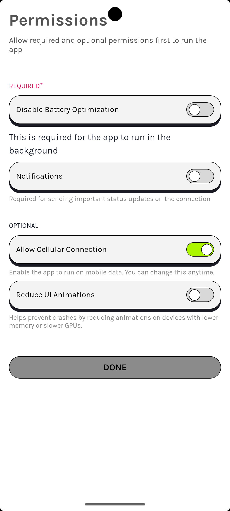
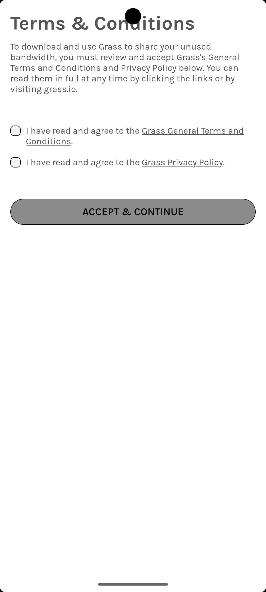
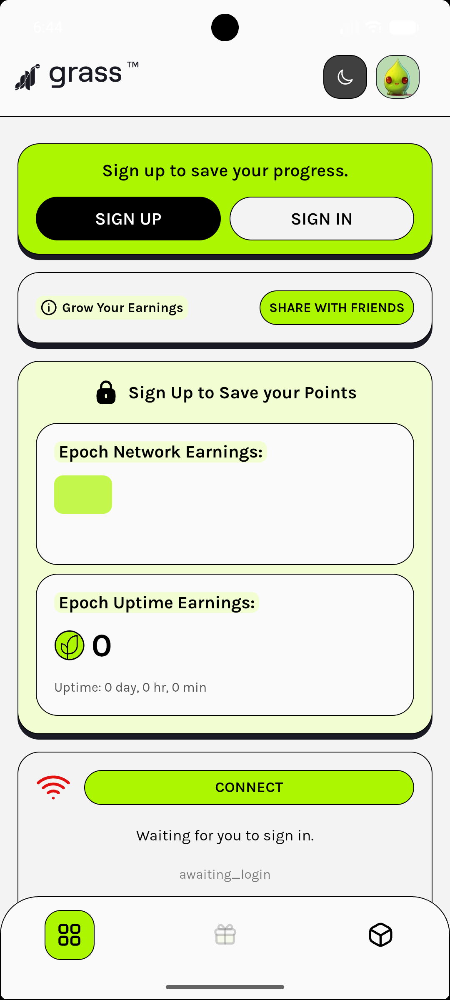
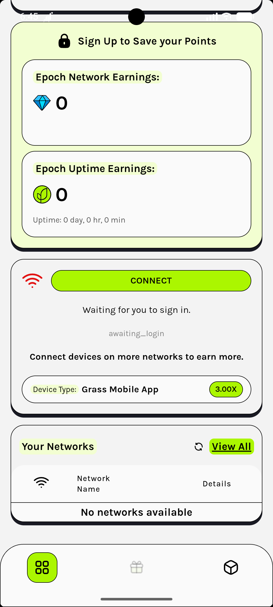
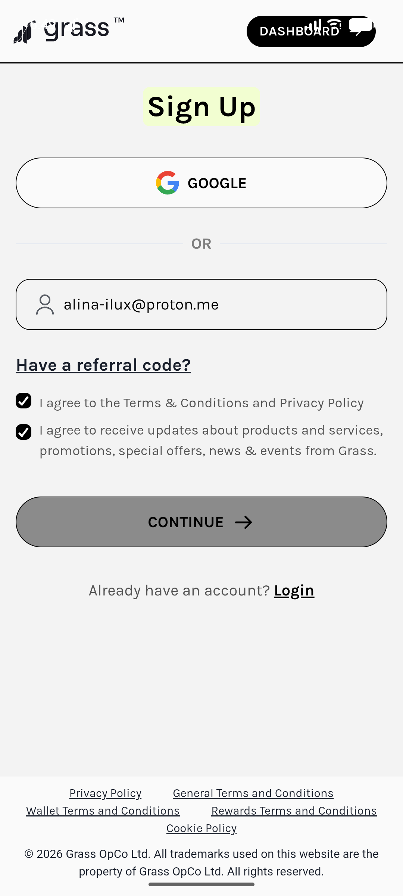
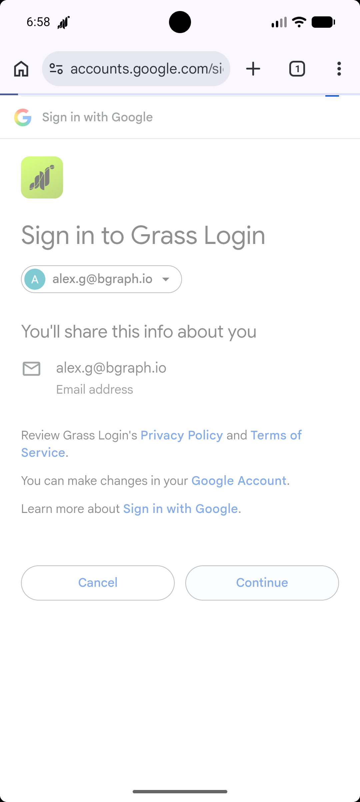
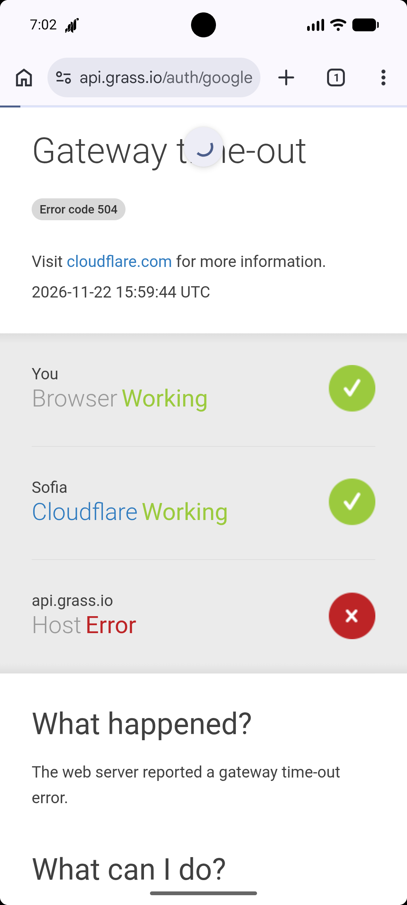

# Grass — первый запуск и онбординг (Android)

Билд: Grass 3.6.1 (`io.getgrass.www`), APK с files.grass.io. Эмулятор Pixel 6a, Android 17. Снято 2026-11-22.
Скриншоты: [`screenshots/grass/`](../screenshots/grass/)

## Схема
```
Запуск → 1. Permissions → 2. Terms & Conditions → 3–4. Главный экран (гость, поинты «под замком»)
       → SIGN UP → 5. Форма регистрации (Google / email OTP)
                     ├─ email → OTP не приходит ✗
                     └─ Google → 6. Согласие Google → 7. api.grass.io/auth/google → 504 ✗
```
Главное: **регистрация не делается до использования**. Сначала разрешения и условия, потом пользователь сразу попадает на дашборд. Аккаунт нужен только чтобы «сохранить» поинты и включить CONNECT.

---

## 1. Permissions


Первый экран после запуска, нативный.
- Заголовок «Permissions», подзаголовок «Allow required and optional permissions first to run the app».
- **REQUIRED\***:
  - **Disable Battery Optimization** — «This is required for the app to run in the background».
  - **Notifications** — «Required for sending important status updates on the connection».
- **OPTIONAL**:
  - **Allow Cellular Connection** — **включён по умолчанию**: «Enable the app to run on mobile data. You can change this anytime». Это тёмный паттерн: делиться мобильным трафиком пользователь начнёт, ничего не выбирая.
  - **Reduce UI Animations** — «Helps prevent crashes… lower memory or slower GPUs». Косвенно признают, что приложение тяжёлое.
- Кнопка **DONE** неактивна (серая), пока не включены оба обязательных тумблера.
- Стиль: тумблеры в карточках с жёсткой чёрной тенью (neo-brutalism), акцентный салатовый.

## 2. Terms & Conditions


- Текст: «To download and use Grass to **share your unused bandwidth**, you must review and accept…». Суть продукта названа прямо.
- Два отдельных чекбокса: General T&C и Privacy Policy (со ссылками).
- **ACCEPT & CONTINUE** неактивна до двух галочек.
- Отдельного экрана согласия на шаринг трафика нет: согласие спрятано в принятии T&C.

## 3–4. Главный экран (гость)
 

Пользователь попадает на дашборд без аккаунта. Сверху вниз:
1. **Хедер**: лого grass™, кнопка тёмной темы, аватар-маскот (зелёная капля с глазами).
2. **«Sign up to save your progress.»** — яркая салатовая карточка, SIGN UP (чёрная, основная) и SIGN IN.
3. **«Grow Your Earnings»** + SHARE WITH FRIENDS — рефералка на главном экране, до регистрации.
4. **«🔒 Sign Up to Save your Points»**:
   - *Epoch Network Earnings* 💎 — поинты за проданный трафик (на скрине 3 скелетон-лоадер).
   - *Epoch Uptime Earnings* 🌿 + «Uptime: 0 day, 0 hr, 0 min».
   - Приём «потерь»: поинты как будто уже есть, но пропадут без регистрации.
5. **Блок подключения**: иконка Wi-Fi (красная = офлайн), кнопка **CONNECT**, статус «Waiting for you to sign in.» и сырой технический код `awaiting_login` (внутренний статус виден пользователю).
   - «Connect devices on more networks to earn more.» — стимул ставить на разные устройства и в разных сетях.
   - **Device Type: Grass Mobile App — 3.00X**. Мобильное приложение даёт множитель ×3 (выгодно Grass: мобильные и резидентные IP ценнее).
6. **Your Networks** (обновить, View All): таблица Network Name / Details, сейчас «No networks available». Учёт сетей (IP), через которые работало устройство.
7. **Таб-бар**: Дашборд (активен) · 🎁 Rewards (серый, вероятно недоступен гостю) · 📦 кубик (вероятно Wallet / устройства).

## 5. Регистрация (WebView)


- Веб-страница внутри приложения (с хедером сайта и кнопкой DASHBOARD →).
- **GOOGLE** или email (passwordless — дальше одноразовый код).
- «Have a referral code?» — раскрывающееся поле.
- Чекбоксы: T&C + Privacy (обязательный, ещё раз после экрана 2) и маркетинговые рассылки (опциональный).
- **CONTINUE** неактивна, пока не пройдена невидимая reCAPTCHA. Без сети кнопка просто серая, объяснения нет.
- Внизу 5 юридических документов: Privacy, General T&C, Wallet T&C, Rewards T&C, Cookie.
- **Email**: одноразовый код не пришёл.

## 6–7. Вход через Google — сломан
 

- Google OAuth открывается во **внешнем браузере** (Chrome), а не в приложении. OAuth-клиент называется «Grass Login», делится только email.
- После Continue идёт редирект на `api.grass.io/auth/google` → **Cloudflare 504 Gateway time-out** («api.grass.io — Host Error»). Время 15:59 и 16:05 UTC.
- Повторная попытка («You're signing back in to Grass Login») заканчивается тем же 504.
- Итог: на момент теста **зарегистрироваться нельзя ни одним способом**. Бэкенд авторизации лежит, приложение не сообщает об ошибке и не предлагает запасной путь.

---

## Наблюдения по онбордингу
- **Ценность раньше регистрации**: сразу дашборд с поинтами, аккаунт подаётся как «сохранить прогресс». Сильный приём, но CONNECT без логина не работает, то есть «прогресс» гостя фактически нулевой.
- **Согласие на шаринг** растворено в T&C. Мобильные данные включены по умолчанию.
- **Двойное принятие T&C**: в нативном онбординге и ещё раз в веб-форме.
- **Геймификация уже на первом экране**: эпохи, два типа поинтов, множитель устройства ×3, сети, рефералка.
- **Смешение нативного и веба**: разрешения нативные, регистрация в WebView, Google-логин во внешнем браузере. Пользователь трижды меняет контекст.
- **Ошибки не обрабатываются**: сырой `awaiting_login`, неактивная кнопка без пояснения, голый 504 от Cloudflare.
