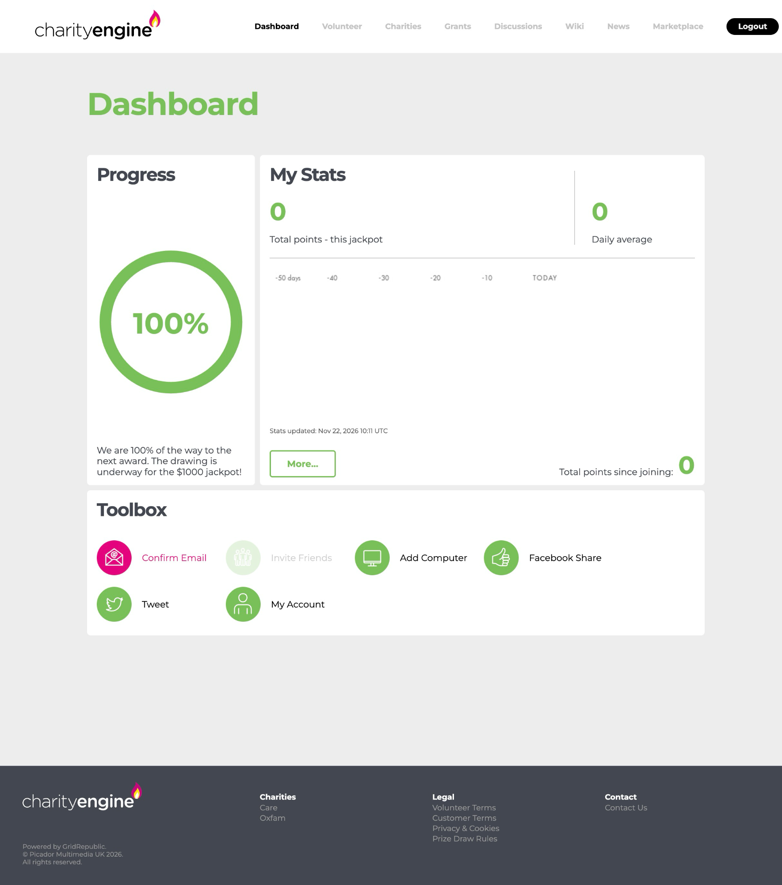
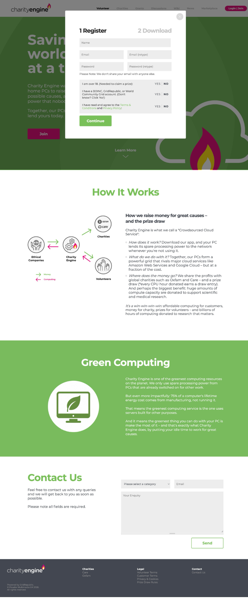

# Charity Engine

## Суть / модель
<!-- что делает, как зарабатывает, куда идут деньги/ресурсы -->
- Пользователь отдаёт простаивающие ресурсы ПК (CPU/GPU, память, диск, интернет-канал). Charity Engine продаёт их как дешёвое облако («Crowdsourced Cloud»). Пользователю денег не платят: прибыль делят фонды (Oxfam, CARE), призовой фонд розыгрыша и сама компания (до 50%). Часть мощности (минимум 5%) бесплатно отдаётся научным BOINC-проектам.
- Разбор лендинга по NMT: [02-charity-engine-landing-nmt.md](02-charity-engine-landing-nmt.md)

## Платформы и онбординг
- Ставится только на Windows (полноценный установщик) и Linux (обычный BOINC, подключение вручную). Сборка для Mac из 2013 года не работает. Подробности в разделе «Разбор установщиков».
- Через сайт: Join → окно «1 Register → 2 Download» → регистрация → загрузка установщика с токеном в имени файла.
- Через прямую загрузку: можно скачать и считать без аккаунта (анонимный токен), регистрация нужна только для приза.

## Функционал

## Интерфейс (экран за экраном)
Скриншоты: [`screenshots/charity-engine/`](../screenshots/charity-engine/)

### 1. Окно регистрации (поверх лендинга /volunteer)

- Модальное окно поверх hero, шаги **«1 Register» → «2 Download»** (второй шаг серый). Сразу видно, что загрузка только после регистрации.
- Поля: Name, Email + Email (retype), Password + Password (retype). Двойной ввод email и пароля — 5 полей, как в 2010-х.
- «Please Note: We don't share your email with anyone else.»
- Три вопроса с переключателем **YES | NO**:
  - «I am over 18. (Needed to claim a prize)»;
  - «I have a BOINC, GridRepublic, or World Community Grid account. (Don't know? Click 'No')» — технический вопрос, для обычного человека непонятный;
  - согласие с Terms & Conditions и Privacy Policy — тоже YES/NO-переключатель вместо чекбокса.
- Кнопка **Continue**. Входа через Google/Apple нет.
- Ни платформ, ни размера загрузки, ни того, что будет установлено (VirtualBox), в окне не сказано.

### 2. Дашборд (после входа)

Меню: Dashboard · Volunteer · Charities · Grants · Discussions · Wiki · News · Marketplace · Logout. Кнопки «Download» в меню нет.

- **Progress** — большое зелёное кольцо **100%** и текст «We are 100% of the way to the next award. The drawing is underway for the $1000 jackpot!».
  - Только здесь, после регистрации, впервые названа сумма приза — $1000.
  - Шкала общая для всех, а не личная. 100% у нового пользователя с 0 очков выглядит как застывшее значение. В FAQ даже есть вопрос «When is the drawing progress meter reset from 100%?», то есть шкала висит на 100% подолгу, а розыгрыши задерживаются (в новостях «long overdue»).
- **My Stats**:
  - «Total points – this jackpot» = 0, «Daily average» = 0;
  - график за 50 дней (−50 days … TODAY), пустой;
  - «Stats updated: Nov 22, 2026 10:11 UTC» — статистика обновляется раз в сутки или реже, мгновенной обратной связи нет. Вики: «Credits take a few days to enter the Charity Engine system»;
  - кнопка **More…** (страница More Stats);
  - «Total points since joining: 0».
  - Нигде нет ни денег, ни вклада в благотворительность: только очки = записи в розыгрыш.
- **Toolbox** — 6 круглых иконок:
  - **Confirm Email** — розовая, выделена (подтверждение почты не обязательно для входа, но висит как задача);
  - **Invite Friends** — бледная, неактивная (видимо, до подтверждения email);
  - **Add Computer** — путь к загрузке установщика спрятан здесь;
  - **Facebook Share**, **Tweet** (старая птичка Twitter);
  - **My Account** (там вкладка Entry Numbers — номера в розыгрыше).
- Пустое состояние никак не объяснено: нет подсказки «установи программу, чтобы начать», хотя у нового пользователя 0 компьютеров. Главный следующий шаг (Add Computer) стоит третьим в ряду и выглядит так же, как Tweet.

## Мотивация и геймификация

## Плюсы / минусы / наблюдения

## Сырые заметки

---

## Разбор установщиков (2026-11-22)
Запускать не на чем (Windows-приложение, Mac на Apple Silicon), поэтому разбор статический: распаковка архивов и строки из бинарников. Всё делалось в изолированной папке, ничего не запускалось.

### Что лежит в Downloads
| Файл | Что это на самом деле |
|---|---|
| `Charity-Engine-Setup__100_9020900_b8df28db.exe` (115 МБ) | Windows-инсталлятор InstallShield, 32-бит: Charity Engine **7.14.2** + **VirtualBox 6.1.20** (2021). Старая сборка |
| `Charity-Engine-Setup__100_9020900_3fc09757.zip` (6,5 МБ) | **Не Linux.** Внутри `Charity Engine_7.0.76_macOSX_i686` — macOS-инсталлятор **2013 года**, 32-битный (i386). На современных Mac не запустится |

Отдельной Linux-сборки нет вообще. Вики прямо говорит: «There is no customized version of the Charity Engine desktop application for Linux» — ставишь обычный BOINC из репозитория (`apt install boinc-manager boinc-client`), VirtualBox, и в BOINC Manager вручную вводишь адрес charityengine.com как account manager.

### Что отдаёт сайт сейчас
- Любой адрес `/download/<что угодно>` (windows, mac, linux, android) отдаёт один и тот же файл `CharityEngineSetup.exe` — Windows-стаб 176 КБ. То есть кнопки под разные ОС по факту ведут к Windows.
- Стаб (`CharityEngine.Bootstrapper`, подпись GridRepublic, Certum) скачивает `https://www.charityengine.com/files/client/Charity-Engine-Setup_landing.exe` (146 МБ, обновлён 2026-09-08), сверяет SHA-256 и запускает.
- Полный инсталлятор — IExpress-архив, внутри:
  - `ce_7.14.2_windows_x86_64.exe` — брендированный клиент BOINC **7.14.2** (сам файл от 04.2024; BOINC 7.14 вышел в 2019).
  - `VirtualBox-7.2.8-r173730.msi` + `common.cab` — VirtualBox 7.2.8 целиком (с Guest Additions ISO, мануалом, 30 языками).
  - `VC_redist.x64.exe` — рантайм Visual C++.
  - `ce-installer_7.14.2_vbox-7.2.8.exe` — обёртка, которая всё ставит. `install.cfg` = `interactive`.

### Что делает установщик (из строк обёртки)
1. Если BOINC уже стоит — пропускает установку CE («An installation of BOINC exists; skipping CE install»).
2. Тихо ставит VC++: `/install /quiet /norestart`.
3. Тихо ставит VirtualBox: `msiexec /qn ... ADDLOCAL=VBoxApplication,VBoxPython VBOX_INSTALLDESKTOPSHORTCUT=0 VBOX_INSTALLQUICKLAUNCHSHORTCUT=0` — без ярлыков, пользователь может не заметить, что у него появился гипервизор.
4. Тихо ставит клиент: `ce_..._x86_64.exe /S /v"/qn ACCTMGR_LOGIN=anonymous ACCTMGR_PASSWORDHASH=<токен>"`.
5. Проверяет файлы в `%ProgramFiles%\BOINC\` (boinc.exe, boinccmd.exe, boinctray.exe, boincscr.exe — заставка, charityengine.exe) и запускает `charityengine.exe /s`.
6. Логи пишет в `%TEMP%\charityengine-install-*.txt`.

### Анонимный аккаунт до регистрации
- Имя файла несёт токен: `Charity-Engine-Setup__100_<id>_<хэш>`. Токен кладётся в `%ProgramData%\BOINC\login_token.txt`, клиент подключается к charityengine.com как `anonymous` с этим хэшем.
- ID идут подряд на каждое скачивание: у пользователя 9020900, у моих двух скачиваний через минуту — 9020907 и 9020908. Значит, **каждое скачивание создаёт новый анонимный аккаунт**, и всего таких выдано около 9 млн (или счётчик начинается не с нуля).
- Вывод: компьютер начинает считать сразу после установки, без регистрации (как у Grass, ценность раньше аккаунта). Но для приза нужна регистрация и привязка; вики: «I'm running the desktop software, but I don't have a website account. How do I register?»

### Что реально выполняется на компьютере
- Это обычный BOINC под чужим брендом. Какие задачи считать, решает сервер (account manager): `charityengine.com/rpc.php`, публичная конфигурация `<account_manager/><account_creation_disabled/>`. Из бинарника список задач не узнать.
- Сервер подключает клиента к коммерческим задачам Charity Engine и к публичным научным BOINC-проектам (вики: «always at least 5% of the grid»).
- **VirtualBox нужен для коммерческих задач**: на /marketplace клиентам продают «Run any Docker container» — контейнеры заказчиков крутятся в виртуалке на ПК волонтёра.
- **Интернет-канал и IP**: там же продаётся «Smart web crawling… using 500K+ IP addresses» при «500,000+ home PCs». Вероятно, краулинг идёт с домашних IP волонтёров, по сути как у Grass. В условиях для волонтёров есть только общая фраза про «internet bandwidth». На странице для волонтёров и в установщике отдельного согласия на это нет. [вывод, не проверено запуском]

### macOS-сборка 2013 (из zip)
- Устанавливает `/Applications/Charity Engine Desktop.app` (BOINC Manager 7.0.76, i386), заставку `Charity Engine.saver`, данные в `/Library/Application Support/BOINC Data`.
- `acct_mgr_url.xml` → account manager `http://www.charityengine.com/` (публичный ключ подписи сервера), `Branding: BrandId=3`.
- Скин «Charity Engine»: кнопки play/pause/stop, фон, картинки «задача идёт / ждёт / на паузе». Заставка показывает научную графику, смена каждые 30 с.
- Есть `projects/virtualbox` — уже в 2013 предусматривали задачи в виртуалке.

### Наблюдения
- Клиент старый (BOINC 7.14, 2019), Mac-сборке 13 лет, Linux-сборки нет, ссылки «Mac/Linux/Android» отдают Windows-файл. Продукт для волонтёра фактически заморожен, развивается B2B-часть (marketplace).
- Установщик ставит в систему VirtualBox (гипервизор, драйверы ядра) молча и без ярлыков. Для обычного человека это тяжёлое и непрозрачное вмешательство.
- Хороший приём: токен в имени файла позволяет начать без регистрации. Плохой: каждый клик «скачать» плодит анонимный аккаунт, и если не зарегистрироваться, вклад не привязан к человеку и в розыгрыш не попадает.
