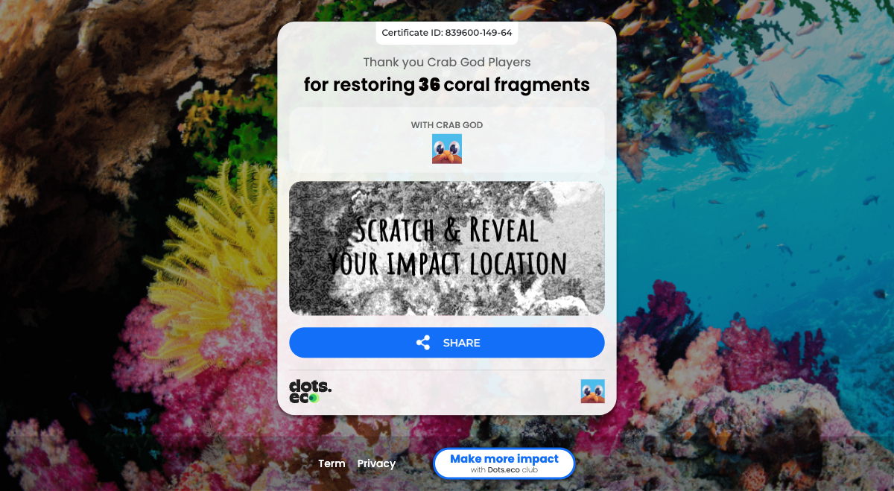
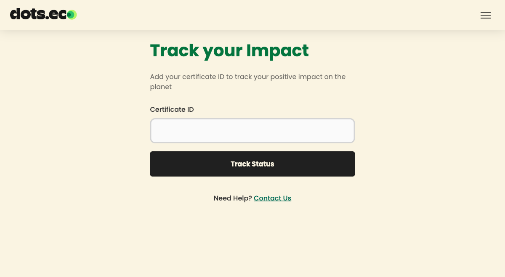
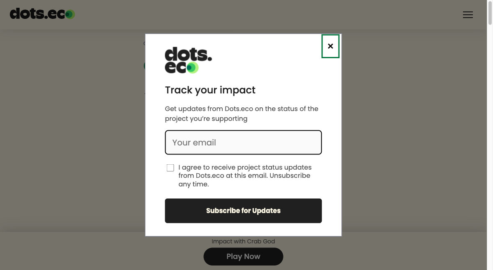
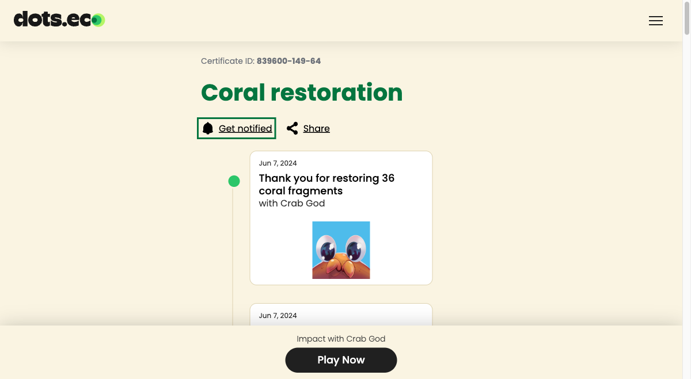
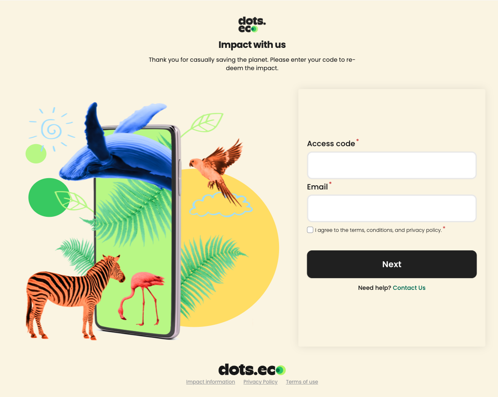
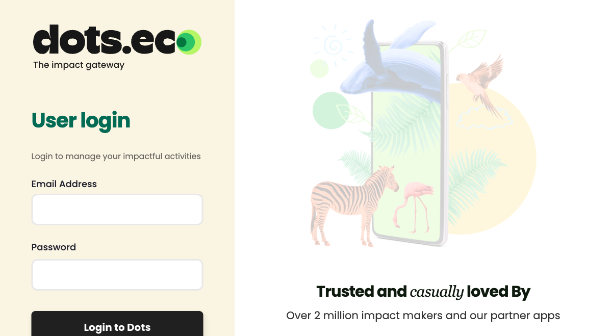
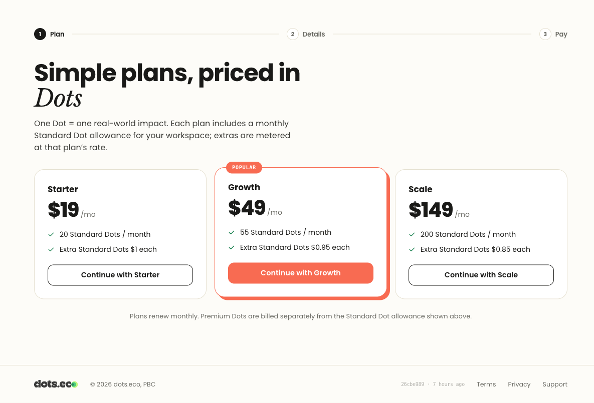
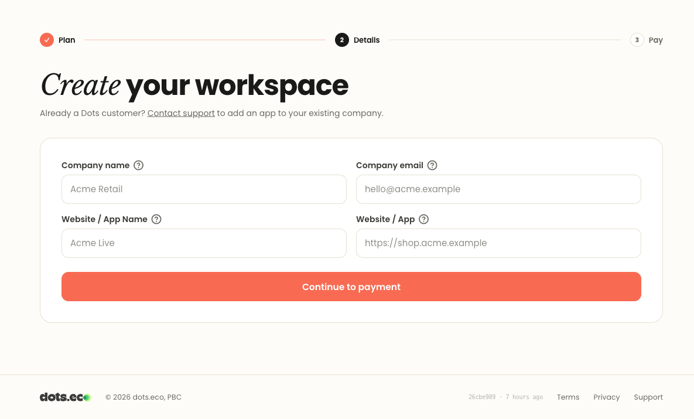
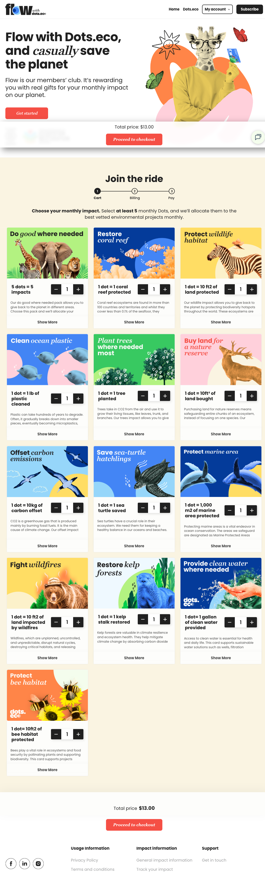

# Dots.eco

Дата разбора: 2026-11-22. Разбор лендинга по NMT: [03-dots-eco-landing-nmt.md](03-dots-eco-landing-nmt.md).
Скриншоты: [`screenshots/dots-eco/`](../screenshots/dots-eco/)

## Суть / модель
- **Своего приложения для пользователя нет.** Ни в App Store, ни в Google Play нет приложения Dots.eco. Это B2B-платформа («impact-as-a-service»): бизнес (игра, программа лояльности, HR-платформа) покупает «Dots» и раздаёт их своим пользователям как награду за действие (прошёл уровень, оставил отзыв, купил бандл).
- **1 Dot = 1 единица реального импакта:** 1 дерево, 1 фунт пластика, 1 черепаха, 10 кг CO2 и т. д. Стоит около $1 (см. self-serve ниже).
- Деньги идут от бизнеса → Dots.eco (комиссия за транзакцию) → экологическому партнёру (40+ НКО, например Coral Guardian, One Tree Planted).
- Пользователь ничего не платит и не «зарабатывает». Он получает **сертификат**: веб-страницу «спасибо, ты восстановил 36 фрагментов коралла» с лентой новостей проекта.
- Второй, побочный продукт: **Flow**, подписка для частных лиц (выбираешь импакты, платишь ежемесячно, около $1 за Dot, минимум 5).

## Что можно посмотреть
Пользовательский опыт живёт внутри чужих игр и приложений. У самого Dots.eco есть только веб-страницы:

| Поверхность | Адрес | Для кого | Что смотрели |
|---|---|---|---|
| Сертификат | `impact.dots.eco/certificate/<uuid>` | конечный пользователь | реальный сертификат игры Crab God |
| Трекинг сертификата | `track.dots.eco` | конечный пользователь | ввели ID, получили ленту обновлений |
| Eco Club (погашение кода) | `impact.dots.eco/app/<id>/eco-club/claim` | пользователь с подарочным кодом | форма, без кода |
| Кабинет бизнеса | `impact.dots.eco/user/login` | бизнес | только экран входа |
| Self-serve покупка | `self-serve.dots.eco` | малый бизнес | тарифы и шаг «Details», до оплаты не доходили |
| Flow | `flow.dots.eco` | частное лицо | конструктор подписки |
| API | `docs.impact.dots.eco` | разработчик | список эндпоинтов |

Чтобы увидеть, как награда выглядит внутри игры, нужно ставить игру-партнёра (Crab God в Steam, Magic Jigsaw Puzzles, Triple Match 3D, FarmVille 3 и др.) и дойти до момента выдачи награды.

## Как продукт выглядит для пользователя (путь целиком)
Для конечного пользователя это не приложение, а одна страница «спасибо» и лента новостей. Dots.eco появляется в трёх точках:

1. **В игре или приложении партнёра** (сами не видели, это сторона партнёра). Ивент («Wildlife Week»), бандл («купи пак — спаси черепаху»), награда за уровень или за отзыв. Игрок получает уведомление со ссылкой, а если партнёр передал email, то и письмо. Регистрации в Dots.eco нет.
2. **Сертификат** (экран 1). Открывается по ссылке без входа: «Thank you Crab God Players for restoring 36 coral fragments». Место проекта открывается через скретч-карту («in Spain»). Есть кнопка Share и ссылка в платную подписку Flow.
3. **Трекинг** (экран 3). По ссылке или по ID на track.dots.eco. Сначала попап с просьбой оставить email, потом лента «спасибо → передано Coral Guardian → проект в Испании → новости с фото дайверов». Внизу закреплена кнопка «Play Now», она возвращает в игру.
4. **Дальше:** письма о новых событиях проекта, если подписался. Личного кабинета, истории всех сертификатов, баланса или очков нет: каждый сертификат живёт отдельно.

Эмоция строится на доказательстве: реальное место, партнёр, фото с датами. Но «твои 36 кораллов» на деле общие для всех игроков, а часть новостей в ленте старше самого вклада. Внимательный игрок это замечает (см. обсуждение Crab God в Steam).

## Платформы и онбординг
- **Конечный пользователь:** онбординга нет. Он узнаёт о Dots.eco в момент награды в игре: ссылка на сертификат, иногда письмо (если бизнес передал email). Аккаунта у пользователя нет: сертификат открывается по ссылке, отследить его можно по ID.
- **Бизнес, путь 1 (основной):** «Book a demo» → звонок с сооснователем → ручная настройка.
- **Бизнес, путь 2 (self-serve, на лендинге не показан):** «Business sign-up» на экране входа ведёт на self-serve.dots.eco: выбор тарифа → данные компании → оплата. Сборка от «7 hours ago», то есть активно разрабатывается прямо сейчас.

## Функционал
- **Выдача импакта через API.** `POST /api/v1/certificate/add`: `app_token`, `allocation_id` (какой проект), `impact_qty`, `remote_user_id`; опционально имя на сертификате, email, дизайн, язык, `external_unique_id` для защиты от дублей. Ответ: `certificate_url`, `certificate_image_url`, `impact_status`, страна, координаты.
- Если email не передан, генерируется `{remote_user_id}@dots.eco`, то есть пользователь получит только ссылку внутри игры.
- **Коды погашения (Eco Club):** бизнес покупает коды (подарочные карты, корпоративные подарки), пользователь вводит код и email на странице claim и получает сертификат.
- **Отчётность для бизнеса:** эндпоинты Impact Summary, список сертификатов, баланс приложения, доступные аллокации.
- **No-code:** Dynamic URL, Braze, n8n, Zapier, Google Sheets, CSV, Unity SDK.
- **Интеграция с Wallet API** (цифровые карточки в Apple/Google Wallet), в доках упомянута одной строкой.
- Песочницы / тестового режима в документации не нашёл.

## Интерфейс (экран за экраном)

### 1. Сертификат (impact.dots.eco/certificate/…)

- Title вкладки: «Join me in protecting the planet with Crab God», заточен под шаринг.
- Карточка поверх фото кораллового рифа: «Certificate ID: 839600-149-64», «Thank you Crab God Players / for restoring **36** coral fragments», иконка игры.
- **«Scratch & Reveal your impact location»**: скретч-карта, под ней страна («in Spain»). Единственный игровой элемент во всём продукте, и хороший: маленький сюрприз вместо голой цифры.
- Синяя кнопка **Share**.
- Внизу «Make more impact with Dots.eco club» → Flow (utm `certificate-v2`). Сертификат работает как воронка в собственную подписку.
- **Сертификат коллективный, а не личный:** «Thank you Crab God Players». Разработчик Crab God в Steam объяснил: 10% выручки за месяц идут в общий пул, игроки только голосуют, куда. Сертификаты выпускаются раз в месяц на всех. Игрок поймал магазин на формулировке «прогресс помогает» и назвал её вводящей в заблуждение; разработчик пообещал исправить страницу.

### 2. Трекинг: ввод ID (track.dots.eco)

- Одно поле «Certificate ID» и кнопка «Track Status». Логина нет: кто знает ID, тот видит. Это удобно, но аккаунта, где собраны все твои сертификаты, тоже нет.
- «Need Help? Contact Us» ведёт на mailto.

### 3. Трекинг: лента импакта (track.dots.eco/certificate/status/…)
 

- **Сразу всплывает попап** «Track your impact — Get updates from Dots.eco…» с полем email и чекбоксом согласия. Сначала email, потом контент.
- Под попапом: заголовок «Coral restoration», кнопки «Get notified» и «Share», вертикальный таймлайн карточек:
  1. «Thank you for restoring 36 coral fragments with Crab God» (Jun 7, 2024);
  2. «Partner allocation — assigned to Coral Guardian»;
  3. «Partner update — The environmental partner has been informed»;
  4. «Project allocation — Restoring the Mediterranean Coral Reefs of Spain», с описанием;
  5. дальше новости проекта с фото и именами фотографов: «Coral Transplant Success!», «Punta de la Mona Fully Protected», «Reaching the deeper corals» (Jul 21, 2026) и т. д. Всего около 15 карточек за 2 года.
- Снизу прилипшая плашка «Impact with Crab God / **Play Now**» → страница игры в Steam. Трекинг возвращает трафик партнёру.
- Огрехи:
  - Новости датированы апрелем 2024, а сертификат июнем 2024: человеку показывают события, случившиеся до его вклада, как будто это его результат («Thanks to your support…»).
  - Карточка «Deep Cleanup Success in Spain» (May 30, 2025) повторяется дважды.
  - Подписи к фото местами — имена файлов («José Salido_Coral Soul.png», «6. Spain_HealthyCoral_credit…»).
  - Опечатка «Our filed partner».
  - Цифры в новостях относятся ко всему проекту (318 кораллов, 1 497 кг мусора), связь с «твоими 36» нигде не показана.
- Сильная сторона: это **лучший пример «показать результат после действия»** среди разобранных приложений. Живые фото с места, понятная цепочка «твой вклад → партнёр → проект → новости», уведомления о новых событиях.

### 4. Eco Club: погашение кода

- «Impact with us / Thank you for casually saving the planet. Please enter your code to redeem the impact.»
- Поля «Access code*», «Email*», чекбокс согласия, кнопка «Next». Слева фирменная иллюстрация (кит, зебра, фламинго вокруг телефона).
- Email обязателен, на него приходит сертификат.

### 5. Вход для бизнеса

- «The impact gateway», «User login — Login to manage your impactful activities», Email + Password, «Login to Dots», ссылка **«Business sign-up»**.
- Справа «Over **2** million impact makers», а на главной «Over **4** million». Цифры на разных поверхностях расходятся.

### 6. Self-serve: тарифы

- Шаги «1 Plan → 2 Details → 3 Pay». «Simple plans, priced in *Dots*. One Dot = one real-world impact.»
- **Starter $19/мес** (20 Dots, сверх $1), **Growth $49** (55 Dots, сверх $0.95, «Popular»), **Scale $149** (200 Dots, сверх $0.85).
- «Premium Dots are billed separately» — что такое Premium Dots, не объяснено.
- Это первая публичная цена Dots.eco: на лендинге страницы цен нет, и в NMT-разборе лендинга это записано как отсутствующее.

### 7. Self-serve: данные компании

- «Create your workspace»: Company name, Company email, Website / App Name, Website / App, кнопка «Continue to payment». Всего 4 поля, без пароля (видимо, позже или magic link).
- «Already a Dots customer? Contact support to add an app» — второе приложение к существующей компании добавляется только через поддержку.

### 8. Flow: конструктор подписки

- Hero «Flow with Dots.eco, and casually save the planet», жираф в очках с карточкой.
- «Join the ride»: шаги Cart → Billing → Pay. «Choose your monthly impact. Select at least 5 monthly Dots».
- 13 карточек импакта с картинками и счётчиком −/+: коралл, дикая природа, пластик, деревья, земля под заповедник, CO2, черепахи, морские территории, пожары, водоросли-ламинарии, чистая вода, пчёлы, «Do good where needed».
- **По умолчанию в каждой карточке уже стоит 1**: итог сразу «Total price: $13.00». Пользователь, не тронув ни одной кнопки, уже набрал 13 Dots, хотя просили минимум 5. Получается тёмный паттерн предвыбора.
- Липкая плашка «Total price / Proceed to checkout», живой чат. В консоли 5 ошибок JS. WordPress + WooCommerce.

## Мотивация и геймификация
- Для конечного пользователя: чувство «я сделал доброе дело, просто играя» + доказательство (фото, место, партнёр). Скретч-карта с локацией, шаринг, уведомления о новостях проекта.
- Никаких очков, уровней, стриков, накоплений у самого Dots.eco нет: вся геймификация на стороне игры-партнёра (бандлы, ивенты, «Ritual Stones» в Crab God).
- Нет личного кабинета, поэтому нет и истории «всё, что я сделал за год». Каждый сертификат живёт отдельно.

## Плюсы / минусы / наблюдения
**Плюсы**
- Трекинг-лента — сильнейшая часть: превращает абстрактное «посадили дерево» в историю с фото и датами. Доверие строится показом, а не словами.
- Сертификат без регистрации: ноль трения, открыл ссылку и видишь.
- Каждая пользовательская поверхность ведёт трафик дальше: в игру партнёра («Play Now») и в собственную подписку Flow.
- Появился self-serve с прозрачными ценами — спуск в малый бизнес.

**Минусы**
- Пользователь Dots.eco не знает и не выбирает: бренд вторичен, лояльность принадлежит игре.
- «Твой импакт» часто коллективный и заранее оплаченный пулом (Crab God), а подаётся как личный. Новости проекта до даты вклада подаются как результат вклада. Риск обвинения в гринвошинге — ровно то, от чего Dots.eco защищает бизнес на лендинге.
- Попап сбора email поверх контента сразу при открытии трекинга.
- Небрежность в контенте: дубли карточек, имена файлов вместо подписей, расхождение 2 млн / 4 млн.
- Flow: предвыбор 13 Dots вместо минимальных 5.

**Что взять нашему продукту**
- Ленту «твой вклад → куда ушёл → что там происходит сейчас» с реальными фото и датами.
- Доступ к результату без регистрации, по ссылке.
- Маленький сюрприз при получении (скретч-карта локации).
- Но: честно разделять личный вклад и общий пул, и не показывать события до вклада как его результат.

## Сырые заметки
- Источники: реальный сертификат Crab God из [обсуждения в Steam](https://steamcommunity.com/app/2289390/discussions/0/4352247346362847591/); [документация API](https://docs.impact.dots.eco/), [Create Certificate](https://docs.impact.dots.eco/endpoints/certificateRequestAllocation/); [интеграция Braze](https://www.braze.com/docs/partners/additional_channels_and_extensions/extensions/rewards/dots_eco).
- До оплаты в self-serve и Flow не доходили, в кабинет бизнеса не входили (нет аккаунта).
- `company.dots.eco` (встречается в CORS-заголовках impact.dots.eco) не резолвится в DNS: видимо, внутренний или выключенный адрес.
