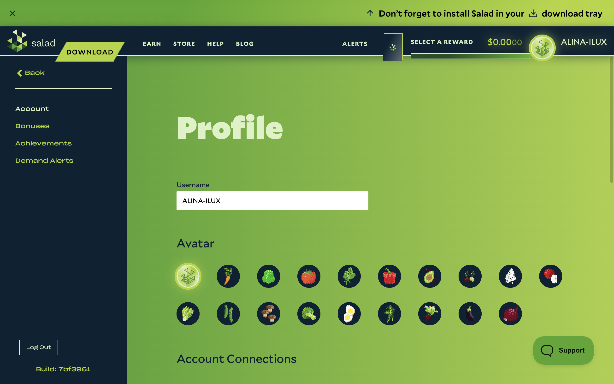
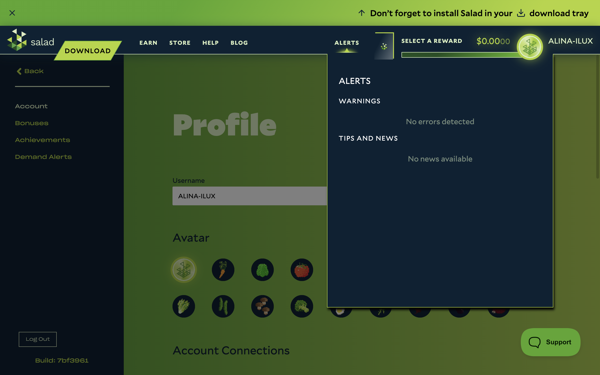
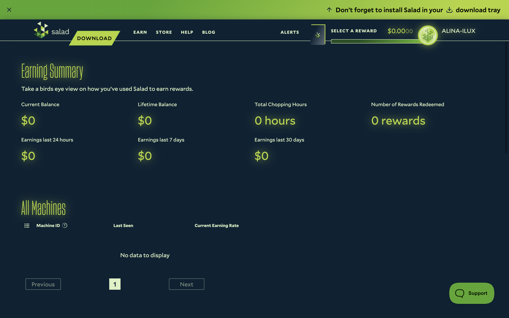
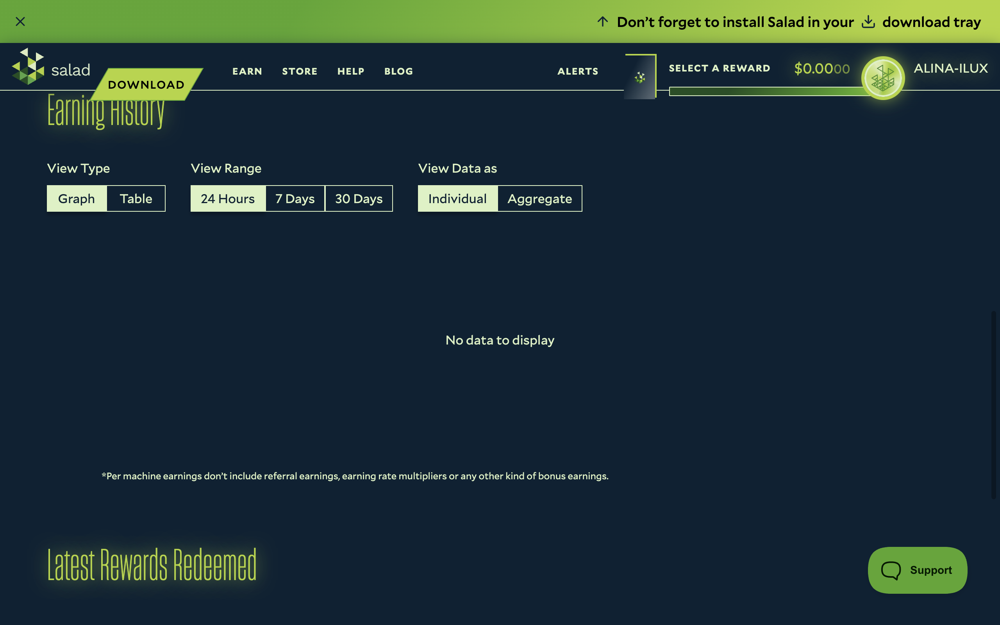
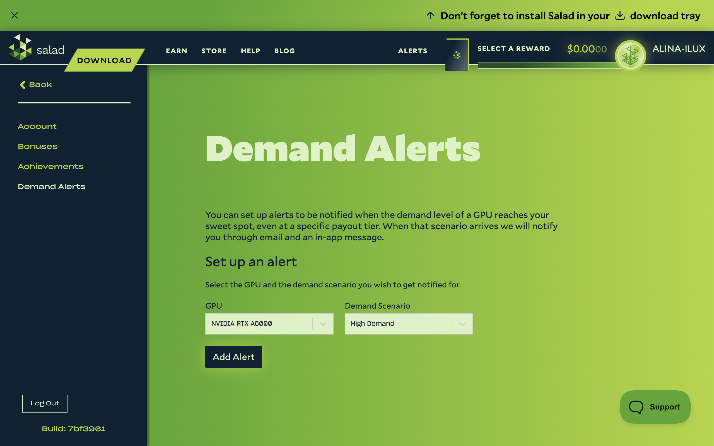

# Salad: как устроен дашборд (веб-кабинет salad.com)

Снято 2026-11-23. Аккаунт: новый, тестовый, баланс $0, машин 0. Сборка кабинета `Build: 7bf3961`.
Метод: исходники веб-кабинета (открыты: github `SaladTechnologies/salad-applications`, `packages/web-app`), живой кабинет залогиненным пользователем, прямые запросы к его API. Десктоп-программа (закрытый код, только Windows) не запускалась.
Скриншоты: [`screenshots/salad/`](../screenshots/salad/) (03, 04, 05, 10–13).

**С данными дашборд не видели**: у аккаунта нет машин, поэтому заполненные график, таблица, ставка машин и карточки выводов описаны по коду (помечены [код]). Экраны глазами пользователя — в [04-salad-onboarding.md](04-salad-onboarding.md).

Пометки: **[факт]** — видно в кабинете или в ответе API; **[код]** — прочитано в исходниках; **[вывод]** — наша интерпретация.

---

## 1. Архитектура

| Слой | Что это | Где |
|---|---|---|
| Интерфейс | **React 18 + MobX 5 + react-jss**, графики на **recharts 2.15**, UI-кит `@saladtechnologies/garden-components`. Один и тот же код работает в браузере (salad.com/earn, /store, /account) и внутри десктоп-программы (Electron). | `packages/web-app` |
| API | `app-api.salad.com`, REST (`/api/v1`, `/api/v2`). Аутентификация — кука сессии плюс заголовок `X-XSRF-TOKEN` (подходит любое значение). Часть клиентов сгенерирована Microsoft Kiota (`v2.machines`). | [факт, код] |
| Поиск по магазину | Elastic App Search (`…app-search.us-east-1.aws.found.io`, движок `salad-rewards-production`). | [факт] |
| Аналитика | **Mixpanel** (`mixpanel-browser` 2.60), но запросы идут **через собственный домен**: `app-api.salad.com/api/v2/mixpanel/track` и `/engage`. Так их не режут блокировщики рекламы. | [факт] |
| Поддержка | Help Scout Beacon (кнопка «Support» справа внизу на всех страницах). | [факт] |
| Контент | Аватары и картинки — Strapi (`assets.salad.com/strapi/...`). | [факт] |

Кабинет — **тонкий клиент без собственной логики подсчёта**: всё считает бэкенд, фронт только опрашивает API и рисует. [вывод]

## 2. Карта экранов

```
Шапка (на всех страницах): DOWNLOAD · EARN · STORE · HELP · BLOG ······ ALERTS · [цель] SELECT A REWARD ▬▬ $0.0000 · аватар · ник

/earn/summary ─── главный дашборд (только для залогиненных)
/earn/demand ──── Network Monitor (публичный)
/earn/dedicated-nodes ── управление выделенными узлами (только у кого есть токен)
/earn ─────────── публичная страница «как зарабатывать»
/store … ───────── магазин, /store/select-target-reward, /store/vault (история выводов)
/account/summary ─ Profile          ┐
/account/referrals (скрыт у новых)  │ левое меню + «Log Out» + «Build: 7bf3961»
/account/bonuses                    │
/account/achievements               │
/account/alerts ── Demand Alerts    ┘
```
[факт + код: `Routes.tsx`, `SettingsPage.tsx`]

Точка входа после логина — `/earn/summary`. Корень `/` редиректит в `/store`: для незалогиненного главная — это магазин. [код]

---

## 3. Шапка — «приборная панель», которая всегда на виду


| Элемент | Что показывает | Откуда данные |
|---|---|---|
| Зелёная плашка сверху | «↑ Don't forget to install Salad in your ↓ download tray». Закрывается крестиком, флаг хранится в профиле. | `profile.withInstallReminder` [код] |
| **DOWNLOAD** | В браузере стартовая кнопка всегда «Download». В десктопе на этом месте кнопка Start/Stop с прогрессом и временем работы. | `StartButtonUIStore` [код] |
| **ALERTS** | Выпадающая панель: «Warnings — No errors detected», «Tips and News — No news available». | см. ниже [факт] |
| Миниатюра + **SELECT A REWARD** + полоса | Целевая награда и прогресс к ней. Полоса = текущий баланс / цена награды; при балансе ≥ цены флаг `canBeRedeemed`. Клик по миниатюре ведёт на страницу награды, по надписи — на выбор цели. | `/api/v1/profile/selected-reward` [факт, код] |
| **$0.0000** | Текущий баланс, 4 знака после точки (последние два мельче). | `/api/v1/profile/balance` [факт] |
| Аватар, ник | Ведут в `/account/summary`. В меню аватара: Profile · Referrals (если включены) · Bonuses · Achievements · Demand Alerts · Logout. | [код] |
| Карточка бонуса | Если есть невостребованный бонус, в шапке появляется маленькая карточка с кнопкой **Claim** (ближайший к истечению). | `bonuses.firstExpiringUnclaimedBonus` [код] |

**Панель Alerts — заглушка.** Компонент ждёт три списка (`news`, `warnings`, `achievements`) и флаг `hasUnseenNotifications`, но контейнер их никогда не передаёт: подставляются пустые массивы. То есть в веб-кабинете панель **всегда пустая**, у любого пользователя. [код: `NavigationBarContainer.tsx` + `NavigationBarWithNotifications.tsx`] Реальные уведомления идут всплывающими тостами внизу слева (`react-toastify`) и, видимо, в десктопе. [вывод]



---

## 4. Главный дашборд `/earn/summary`
 

Сверху вниз шесть блоков. [факт + код: `EarningSummaryPage.tsx`]

### 4.1 Earning Summary — 7 плиток
Подзаголовок: «Take a birds eye view on how you've used Salad to earn rewards.» Сетка 4 колонки (2 на экранах уже 1024 px).

| Плитка | Источник | Как считается |
|---|---|---|
| Current Balance | `/api/v1/profile/balance` → `currentBalance` | как есть |
| Lifetime Balance | там же → `lifetimeBalance` | как есть |
| Total Chopping Hours | `/api/v1/profile/xp` → `lifetimeXp` | **XP / 60**, округление до часа. Подтверждает: 1 XP = 1 минута работы |
| Number of Rewards Redeemed | `/api/v1/reward-vault` | длина списка выводов |
| Earnings last 24 hours / 7 days / 30 days | `/api/v2/reports/30-day-earning-history` | фронт суммирует 15-минутные корзины за нужное окно |

Детали подсчёта [код: `balance/utils.tsx`]:
- API отдаёт словарь `{время: сумма}` за 30 дней. Фронт разворачивает его в сетку **2880 точек × 15 минут** (= 30 суток), пустые слоты заполняет нулями.
- В плитках баланс показывается как `$0`, а в шапке как `$0.0000`. Разный формат одного числа. [факт]

### 4.2 All Machines — таблица машин
- Колонки: чекбокс · **Machine ID** (первые 8 символов, «?» ведёт на гайд «как найти ID машины») · **Last Seen** · **Current Earning Rate**. Пагинация Previous / 1 / Next. [факт]
- Меню над чекбоксами: выбрать все / все на странице / снять. Выбранные машины попадают в график ниже; по умолчанию отмечены первые 5. [код]
- Клик по ID открывает модалку «Summary — xxxxxxxx» с теми же Last Seen и Current Earning Rate. [код]
- **Current Earning Rate** = заработок машины за **последние 5 минут × 12** (`/api/v2/machines/{id}/earnings/5-minutes`), то есть «мгновенная» ставка $/час. Обновляется **раз в минуту**, только для машин на текущей странице. [код]
- Список машин — `/api/v2/machines`. Машины, не выходившие на связь **больше 32 дней, скрываются**. [код]
- Пустое состояние: «No data to display». [факт]

Под таблицей ссылка «Manage your dedicated nodes» — только если у аккаунта есть токен выделенных узлов (у нас `404`). [код + факт]

### 4.3 Earning History — график / таблица
Три переключателя-сегмента [факт]:

| View Type | View Range | View Data as |
|---|---|---|
| Graph · Table | 24 Hours · 7 Days · 30 Days | Individual · Aggregate |

- **Graph**: линейный график recharts, по линии на машину (свой цвет), справа список «Machines (n/N)» с галочками. За 24 часа — по часам, за 7/30 дней — по дням. Тултип с суммой. [код]
- **Table**: строки — машины, колонки — периоды (часы или дни) плюс «Average». [код]
- **Aggregate** — одна суммарная линия. Если выбрано **больше 10 машин**, режим Individual блокируется и включается Aggregate. [код]
- Данные по машинам — `/api/v2/machines/{id}/earning-history?timeframe=24h|7d|30d`. Кэшируются: повторно запрашиваются **не чаще раза в час**. [код]
- Сноска: «*Per machine earnings don't include referral earnings, earning rate multipliers or any other kind of bonus earnings.» То есть сумма линий на графике **не равна** изменению баланса, если есть бонусы или рефералы. [факт + вывод]
- Каждое переключение фильтра уходит в Mixpanel (`trackEarningHistoryFilterClicked`). [код]

### 4.4 Latest Rewards Redeemed
- Карточки последних выполненных выводов (данные из reward-vault плюс `/api/v1/rewards/{id}` для картинки) и кнопка «View Rewards Vault». [код]
- Пусто: «No rewards redeemed yet. Check out your reward progress on the top right of this screen.» — отсылает к целевой награде в шапке. [факт]
- Пока страница открыта, список выводов опрашивается отдельным таймером (`vault.startRefresh`). [код]

### 4.5 FAQ
«Have questions? Check out our FAQS»: «I live outside the U.S. — can I still redeem rewards with Salad?», «How do I redeem a reward?», кнопка «View All FAQs» (support.salad.com). В коде есть третья ссылка «почему я зарабатываю меньше, чем показывает WhatToMine», в живом кабинете её не видно. [факт + код]

---

## 5. Как и когда обновляются данные

| Что | Как часто | Эндпоинт |
|---|---|---|
| Баланс + 30-дневная история | **каждые 5 мин** (глобальный `RefreshService`) | `profile/balance`, `reports/30-day-earning-history` |
| Целевая награда, рефералы, vault, XP, аватары, бонусы | каждые 5 мин | `profile/selected-reward`, `profile/referral*`, `reward-vault`, `profile/xp`, `avatars`, `bonuses` |
| Витрина магазина | каждые 5 мин | `storefront` |
| Текущая ставка машин | **каждую минуту**, пока открыт дашборд | `machines/{id}/earnings/5-minutes` |
| История по машинам | при открытии, не чаще раза в час | `machines/{id}/earning-history` |
| Баннер новостей | каждые 5 мин, даже без логина | `notification-banner` |

[код: `RefreshService.tsx`, `config.tsx` (`dataRefreshRate` = `rewardRefreshRate` = 5 мин)]

Вывод: баланс в шапке **не живой** — растёт ступеньками раз в 5 минут, а не тикает. Ощущение движения создают 4 знака после точки. [вывод]

---

## 6. Остальные экраны кабинета

### Profile `/account/summary`


Username (редактируемый) · **Avatar** — 19 овощей плюс дефолтный, все доступны сразу, к уровню не привязаны · Account Connections: Google (вход через SSO), **Minecraft Username** («required to redeem many Minecraft rewards») · Account Security: **Passkeys** (0/30) · **Solana Wallet** для наград токеном RENDER («token rewards sent to the wrong address cannot be recovered»). [факт]

### Bonuses `/account/bonuses`
Пусто: «No unclaimed bonuses available». Бонус — предмет или множитель ставки; второй множитель предлагают **заменить** текущий (модалка «Replace Current Earning Rate?»). `/api/v2/bonuses` → `[]`, `/api/v2/bonuses/earning-rate` → 404 (активного множителя нет). [факт]

### Achievements `/account/achievements`
23 ачивки, разобраны в [04-salad.md](04-salad.md#ачивки-23-шт-accountachievements). Данные — `/api/v2/achievements`. [факт]

### Demand Alerts `/account/alerts`


«You can set up alerts to be notified when the demand level of a GPU reaches your sweet spot… we will notify you through email and an in-app message.» Форма: GPU (выпадающий список) + Demand Scenario (High Demand и др.) → **Add Alert**. Подписки — `/api/v2/demand-monitor/subscriptions`. [факт]

### Network Monitor `/earn/demand` (публичный)
Источник — `/api/v2/demand-monitor/gpu`. На каждую карту: `demandTierName` (Low / Moderate / High), `utilizationPct`, `earningRates` {min, max, avg, top25Pct}, рекомендуемая RAM. Пример: RTX 5090 Laptop — High, avg $0.109/ч, top-25% $0.116; RTX A5000 — Low, avg $0.00 (диапазон $0.072–0.20). [факт, ответ API 2026-11-23]

### Dedicated Nodes `/earn/dedicated-nodes`
Скрытый B2B-раздел: токен регистрации, список машин с серийным номером и «Endorsement Key Identifier» (TPM), действия Approve / Refuse / Revoke, подтверждение 6-символьным кодом с экрана машины. Для обычного аккаунта — «Dedicated nodes are not set up for this account». [код]

---

## 7. Трекинг поведения (Mixpanel)
Все события идут через прокси `app-api.salad.com/api/v2/mixpanel/*`. Из кода, что касается дашборда [код: `AnalyticsStore.tsx`]:
- `trackEarnPageViewed`, `trackEarningHistoryFilterClicked` (диапазон / тип / агрегирование), `trackEarnPageFAQLinkClicked`, `trackEarnPageVaultButtonClicked`;
- вокруг дашборда: `trackSelectedReward` (выбор цели), `trackRewardView`, `trackRewardSearch`, `trackRewardRedeemed`, `trackHeaderLinkClicked`, `trackSidebarLinkClicked`, `trackToastNotificationShown/Clicked/Closed`;
- из десктопа: `trackStart`, `trackStop`, `trackAutoStart`, `trackMiningError`, `trackUninstall`, `trackOnboardingPageViewed`.

---

## 8. Что работает плохо (на новом аккаунте)
- **Пустые состояния ничего не объясняют.** Семь нулей, «No data to display» в двух местах, пустой Alerts. Нигде нет «чтобы появились данные, установите программу и нажмите Start». [факт]
- **Alerts всегда пуст** — кнопка в шапке есть, но наполнения в вебе нет вообще. [код]
- **Баланс в двух форматах**: `$0.0000` в шапке и `$0` в плитках. [факт]
- **График не сходится с балансом**: бонусы и рефералы в истории по машинам не учитываются, о чём говорит только мелкая сноска. [факт]
- **Уровень-овощ не показан нигде**, хотя XP считается и используется для блокировки вывода; плитка «Total Chopping Hours» — это тот же XP, делённый на 60. [код + факт]
- **Ошибки в консоли у каждого нового пользователя**: «There is no machines», 404 на `avatars/selected` и `bonuses/earning-rate`. [факт]
- `changelog` отдаёт `lastUpdated: 2021-09-24` — раздел «What's new» заброшен. [факт]

## 9. Что взять в наш продукт
1. **Шапка как постоянный счётчик прогресса**: баланс + цель + полоса к ней на каждой странице. Для нас: «сколько добра сделано» + «целевое доброе дело» + полоса.
2. **«Текущая скорость» по последним 5 минутам ×12** — простой и честный способ показать живую ставку без сложной аналитики. Нам подойдёт «сейчас ваш компьютер приносит N в час для фонда X».
3. **Окна 24 ч / 7 д / 30 д + график по устройствам** — минимальный набор, которого хватает; больше Salad не дал за годы.
4. **Не повторять**: пустые экраны без подсказки следующего шага, заглушка Alerts, расхождение графика и баланса, скрытый уровень.
5. **Опрос раз в 5 минут** достаточен для такого дашборда; живые веб-сокеты не нужны.
6. **Mixpanel через свой домен** — рабочий приём, если важна полнота аналитики (но для благотворительного продукта лучше заранее решить, насколько это сочетается с обещаниями о приватности).
