# Salad: как приложение выглядит для пользователя (веб-кабинет)

Сайт и кабинет salad.com, браузер на Mac, новый аккаунт (баланс $0, машин 0). Снято 2026-11-22/23, сборка кабинета `7bf3961`.
Скриншоты: [`screenshots/salad/`](../screenshots/salad/). Техническое устройство дашборда — в [04-salad-dashboard.md](04-salad-dashboard.md), общий разбор и магазин — в [04-salad.md](04-salad.md).
Десктоп-программа (только Windows) не запускалась: её экраны в конце, по справке Salad, помечены **[не проверено]**.

## Схема
```
Сайт (без входа): 0а. /earn «What is Salad Balance?» · 0б. Network Monitor · 0в. Магазин
   → Login → 1. Одна форма входа/регистрации (email / Google / passkey)
           → 2. Код из письма
           → 3. Пустой дашборд Earning Summary  ← сюда попадает каждый новичок
                 ├─ 4. Earning History (пусто)
                 ├─ шапка: 5. Alerts (пусто) · 6. Выбор целевой награды
                 └─ меню аккаунта: 7. Achievements · 8. Profile · 9. Demand Alerts · Bonuses (пусто)
   → [Windows] установка → мастер настройки → Chop Now  [не проверено]
```
Главное: **аккаунт заводится раньше, чем пользователь что-то получил**, а после входа его встречает экран из нулей. Вся настройка и сам заработок — в Windows-программе. В вебе на это намекает одна плашка «Don't forget to install Salad».

---

## 0а. Публичная страница /earn
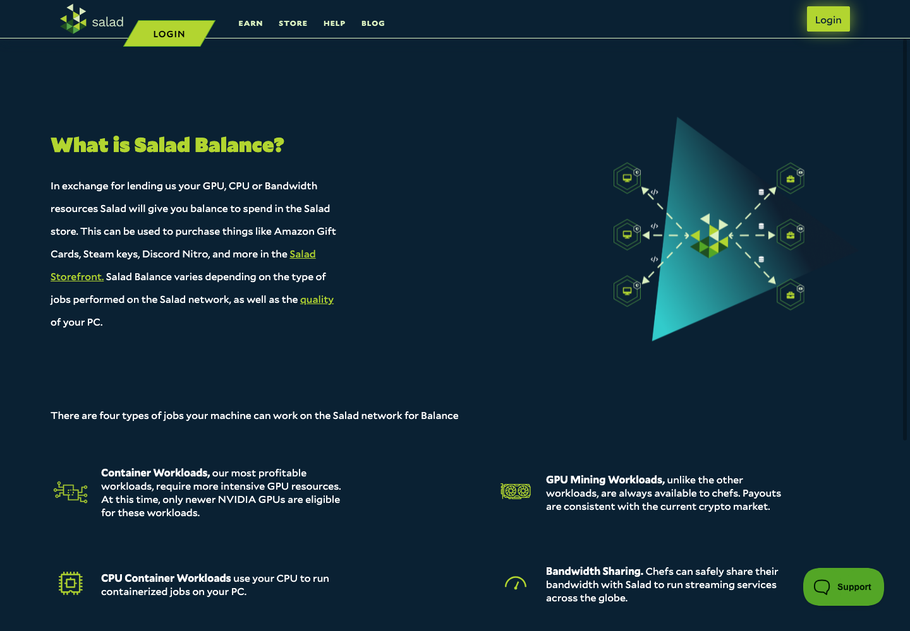

- «**What is Salad Balance?**» — сразу объясняют, что платят не деньгами, а балансом для магазина Salad: «Amazon Gift Cards, Steam keys, Discord Nitro, and more».
- «Salad Balance varies depending on the type of jobs… as well as the quality of your PC» — сумма заранее не обещана.
- Четыре вида работ с иконками: **Container Workloads** («most profitable… only newer NVIDIA GPUs»), **CPU Container Workloads**, **GPU Mining** («always available to chefs»), **Bandwidth Sharing** («to run streaming services»).
- Стиль: тёмно-синий фон, кислотно-салатовые акценты, наклонная плашка-кнопка (LOGIN / DOWNLOAD), кнопка Support справа внизу.

## 0б. Network Monitor (/earn/demand)
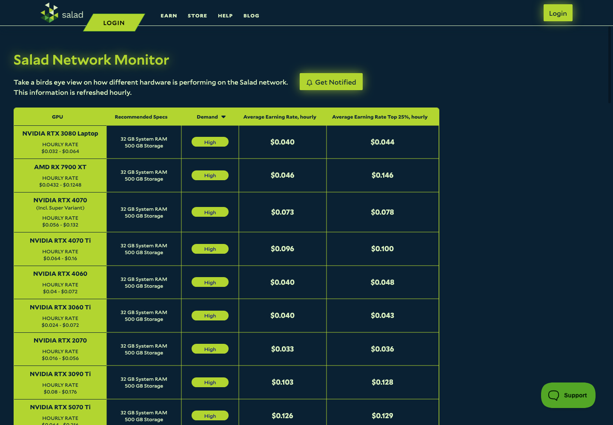

- Публичная таблица по ~50 видеокартам: спрос (High / Moderate / Low), диапазон часовой ставки, средний заработок и средний у топ-25%.
- Единственное место, где до регистрации можно прикинуть, сколько заработает своя карта. Цифры честнее, чем на лендинге (там топ-1%).

## 0в. Магазин без входа
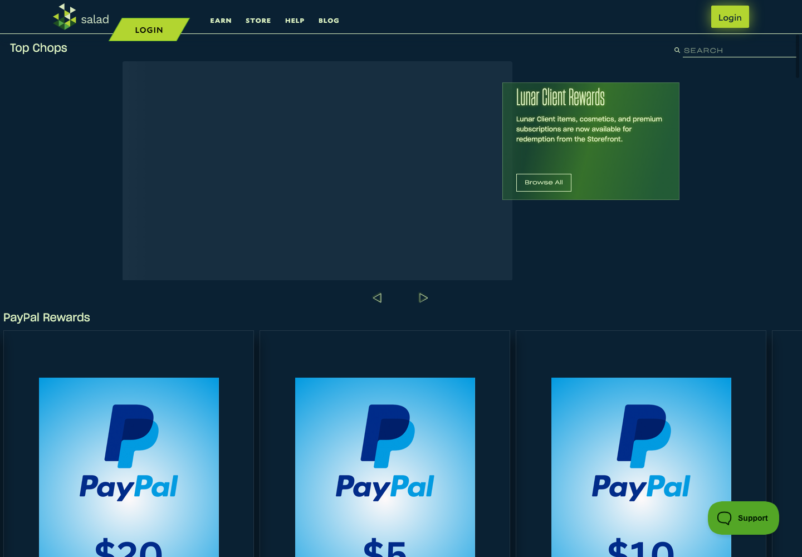

- `/` открывает магазин, а не страницу о продукте: незалогиненный видит **что можно получить** (PayPal, Visa, Steam, Discord Nitro, Roblox…) с ценами в балансе.
- Продаёт желание («хочу Nitro»), а не процесс («сдать видеокарту в аренду»).

## 1. Вход и регистрация — одна форма
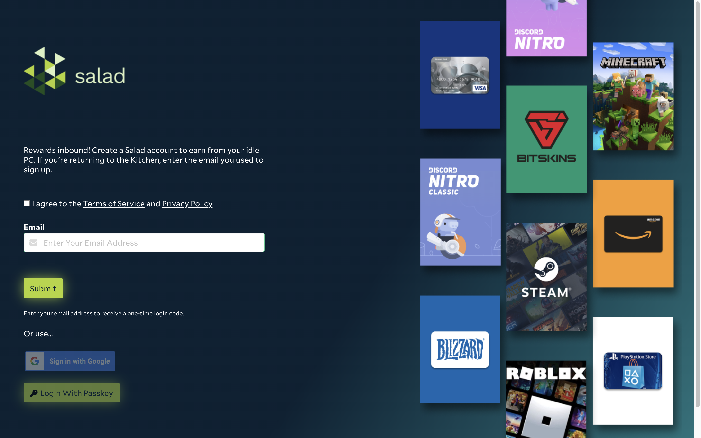

- «Rewards inbound! Create a Salad account to earn from your idle PC. If you're returning to the Kitchen, enter the email you used to sign up.»
- Одно поле Email, без пароля. Обязательная галочка Terms + Privacy, без неё Submit неактивна.
- Альтернативы: Sign in with Google, Login With Passkey.
- Справа коллаж логотипов наград (Visa, Discord, Minecraft, Steam, Amazon, Roblox, PlayStation).
- Внизу: «Known compatibility issues may prevent you from logging in with Brave».

## 2. Код из письма
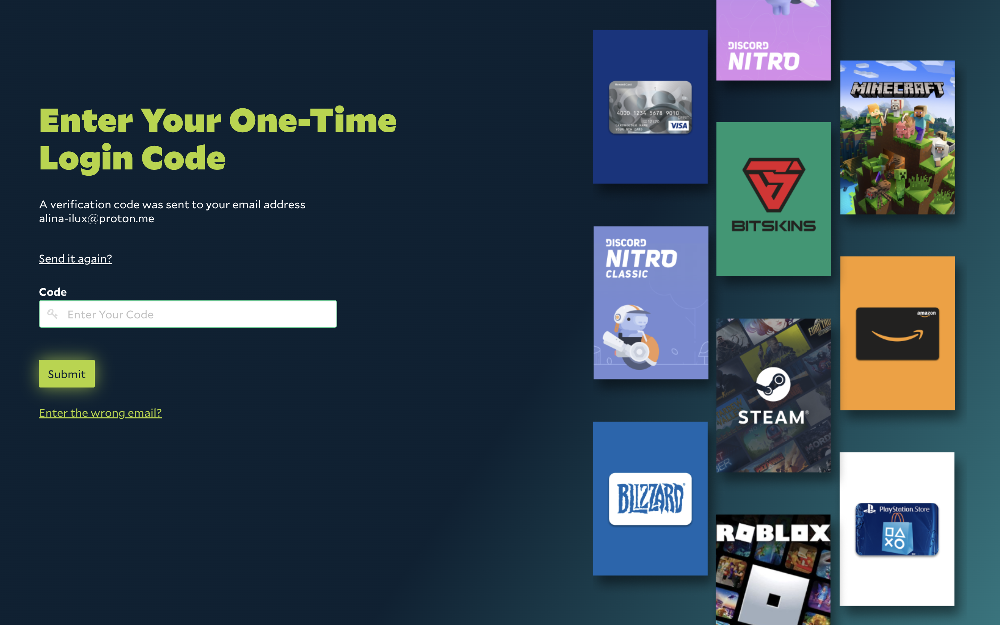

- «Enter Your One-Time Login Code», 6 символов, пришёл за ~1 минуту. «Send it again?» / «Enter the wrong email?».
- Ник создаётся сам из почты (ALINA-ILUX), никаких вопросов о пользователе.

## 3. Первый экран после входа: пустой Earning Summary
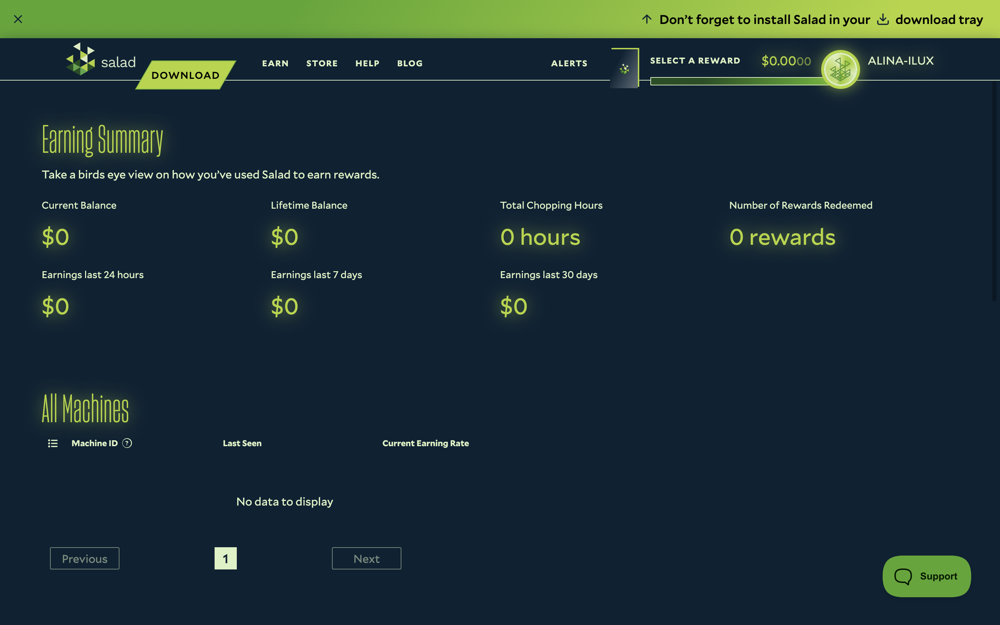

Сверху вниз:
1. **Плашка** «↑ Don't forget to install Salad in your ↓ download tray» — рассчитана на тех, кто только что скачал установщик. С Mac звучит странно.
2. **Шапка**: DOWNLOAD · EARN · STORE · HELP · BLOG · ALERTS · пустая миниатюра цели + «SELECT A REWARD» + полоса · **$0.0000** · аватар · ник.
3. **Earning Summary** — семь плиток: Current Balance $0, Lifetime Balance $0, Total Chopping Hours «0 hours», Number of Rewards Redeemed «0 rewards», Earnings last 24 h / 7 d / 30 d — $0.
4. **All Machines** — таблица Machine ID / Last Seen / Current Earning Rate, «No data to display».
5. **Earning History**, **Latest Rewards Redeemed** («No rewards redeemed yet. Check out your reward progress on the top right of this screen»), **FAQ** (2 вопроса + View All FAQs).

Ни приветствия, ни чек-листа «что дальше», ни кнопки «Установить программу» в теле страницы. Пустые состояния не объясняют, почему пусто.

## 4. Earning History (пусто)
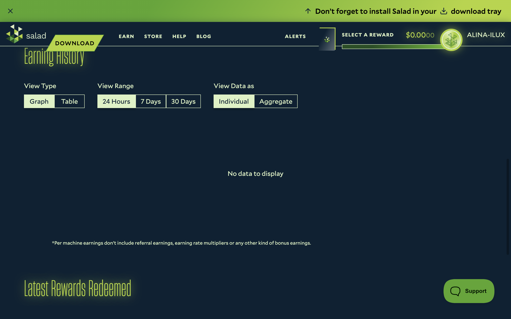

- Три переключателя: **Graph / Table**, **24 Hours / 7 Days / 30 Days**, **Individual / Aggregate**. Все кликаются, но показывают одно и то же: «No data to display».
- Сноска: «*Per machine earnings don't include referral earnings, earning rate multipliers or any other kind of bonus earnings.»
- Как выглядит с данными, не видели (нет машин): по коду — линейный график, по линии на машину, справа список машин с галочками.

## 5. Alerts (кнопка в шапке)
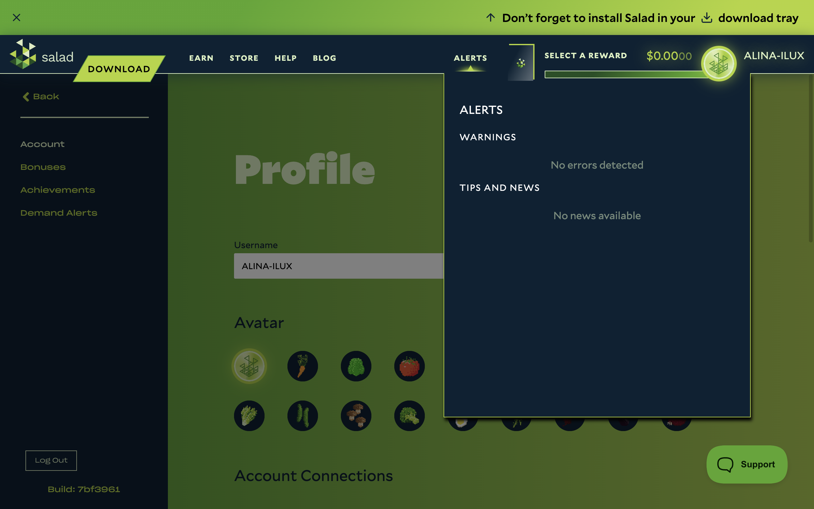

- Выпадающая панель: «Warnings — No errors detected», «Tips and News — No news available».
- По коду в вебе она пустая **всегда**, у любого пользователя. Кнопка есть, наполнения нет.

## 6. Выбор целевой награды
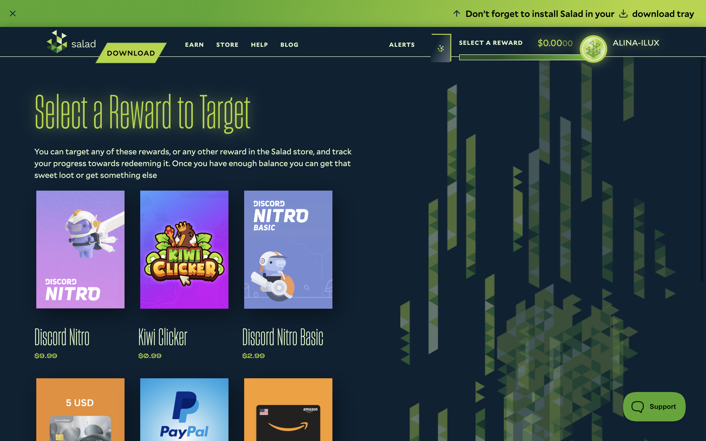

- Клик по «SELECT A REWARD» → «Select a Reward to Target… track your progress towards redeeming it».
- Рекомендации новичку: Discord Nitro $9.99, Kiwi Clicker $0.99, Nitro Basic $2.99, Mastercard $5 за $5.99, PayPal $5 за $5.99, Amazon $10 за $11.
- После выбора миниатюра и полоса в шапке начинают показывать прогресс. Это **самое близкое к онбордингу**, что есть в вебе: единственное действие, которое новичок может сделать без программы и которое что-то меняет.

## 7. Achievements
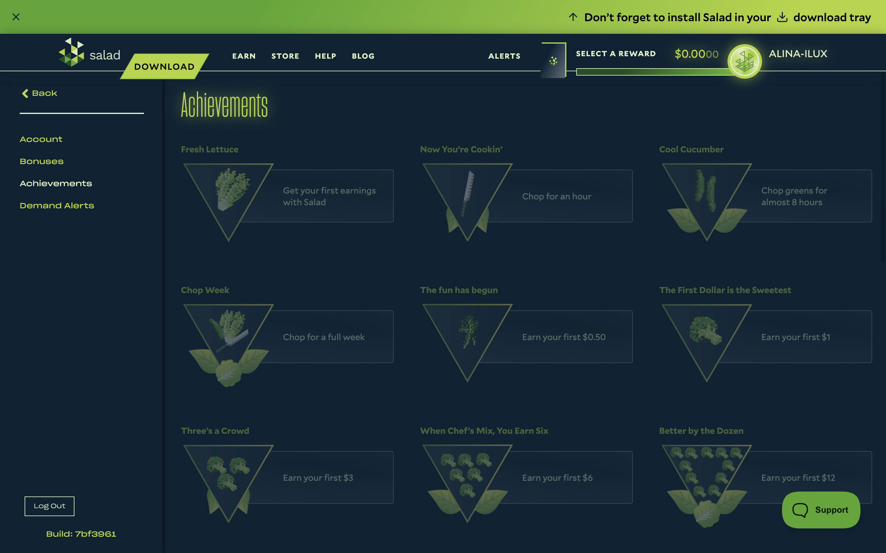

- Сетка треугольников с пиксельными овощами, неполученные — тусклые. Название сверху, условие справа: «Fresh Lettuce — Get your first earnings with Salad», «Now You're Cookin' — Chop for an hour», «Cool Cucumber — Chop greens for almost 8 hours», «Chop Week», «The fun has begun — first $0.50», «The First Dollar is the Sweetest», «Three's a Crowd — $3», «When Chef's Mix, You Earn Six», «Better by the Dozen — $12»… всего 23.
- Первые цели крошечные (час, $0.50) — должны заполнять дни до первого вывода.

## 8. Profile (/account/summary)
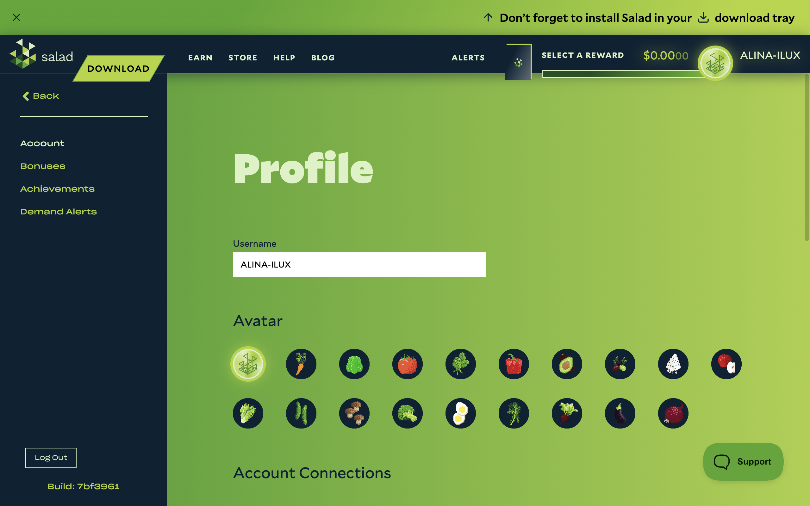

- Слева меню: Back · Account · Bonuses · Achievements · Demand Alerts, внизу Log Out и «Build: 7bf3961». Referrals у нового аккаунта нет.
- Username, **Avatar** — 19 овощей, все доступны сразу.
- Account Connections: Google, **Minecraft Username** («required to redeem many Minecraft rewards»).
- Account Security: **Passkeys (0/30)**, Add a Passkey.
- **Solana Wallet** для наград токеном RENDER («cannot be recovered» при ошибке в адресе).

## 9. Demand Alerts
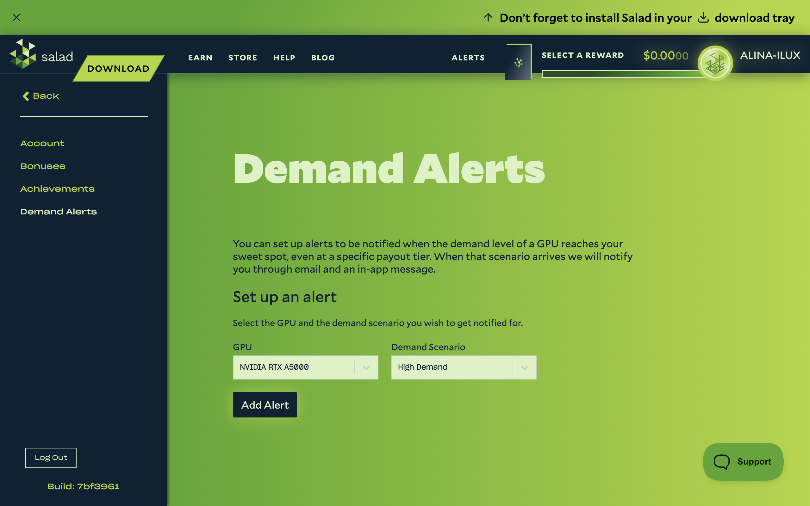

- «You can set up alerts to be notified when the demand level of a GPU reaches your sweet spot… through email and an in-app message.»
- Форма: GPU (список) + Demand Scenario (High Demand…) → Add Alert.
- Инструмент возврата: «не выгодно сейчас — напишем, когда станет».

**Bonuses** (скриншота нет): «No unclaimed bonuses available».

## 10. Десктоп-программа [не проверено, по справке Salad]
- Установка, программа живёт в трее. Вход открывает браузер (экраны 1–2).
- Мастер: добавить Salad в исключения антивируса, поставить WSL, выбрать типы работ; майнинг «presented during signup, enabled by default».
- **Chop Now**: первая задача — проверка совместимости, потом оплачиваемые. Можно включить Auto Start.
- Требования для доходных работ: Windows 10/11, 32 ГБ ОЗУ, 70 ГБ на C:, виртуализация, без VPN.

---

## Наблюдения
- **Ценность показывают до регистрации, но только как витрину**: магазин и Network Monitor открыты без входа. Сильный ход — человек сначала выбирает «хочу Nitro», потом регистрируется.
- **После входа — тупик.** Экран из нулей, пустые графики, пустые Alerts и Bonuses. Единственный шаг вперёд в вебе — выбрать цель. Тот, у кого нет Windows, не узнаёт об этом из кабинета.
- **Регистрация лёгкая**: одно поле, код из письма, без пароля и анкеты. Прямая противоположность Grass, где регистрация лежала.
- **Онбординг разорван между браузером и Windows-программой**, как у Grass (нативное + WebView + внешний браузер): пользователь несколько раз меняет контекст.
- **Геймификация видна сразу**, хотя заработка ещё нет: баланс до 4 знаков, полоса к цели, 23 ачивки, овощные аватары. Уровни-овощи при этом нигде не показаны.
- **Тон дружелюбный, «кулинарный»**: chef, chopping, kitchen, pantry («Fetching (a few) ingredients from the pantry…» на экране загрузки). Неприятные вещи (наценка, «too new to redeem») всплывают только в момент покупки.
