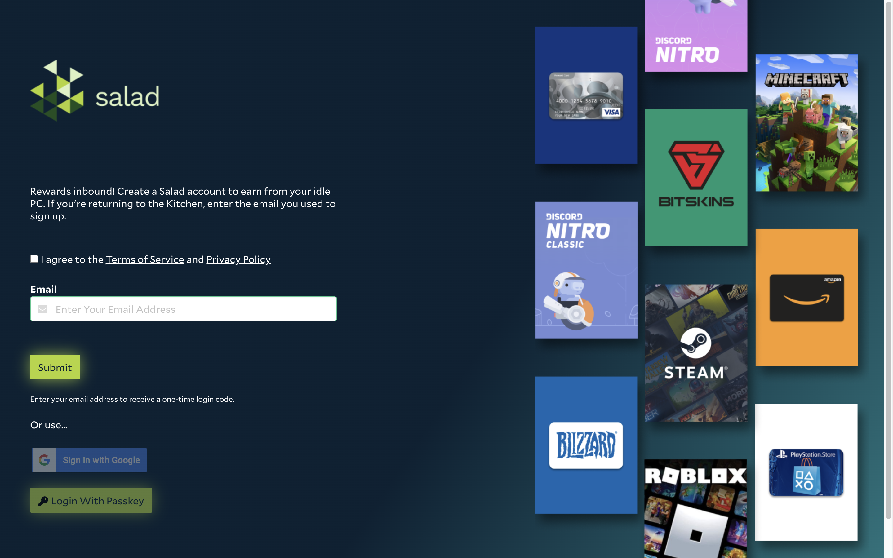
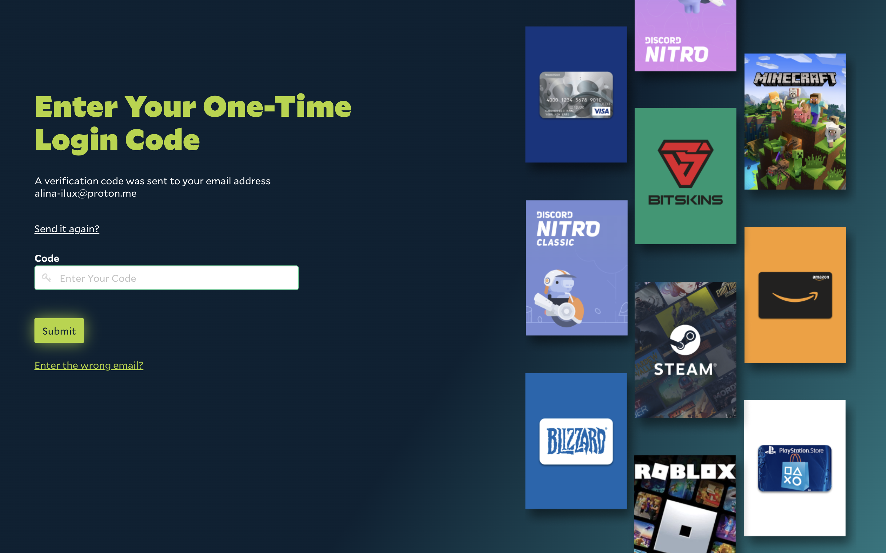
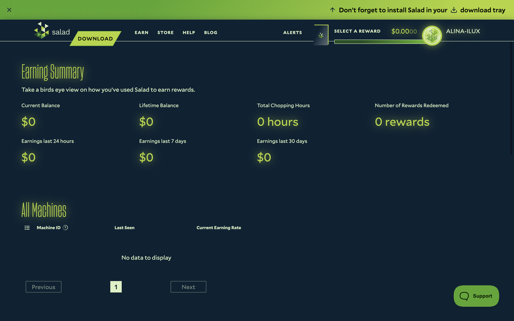
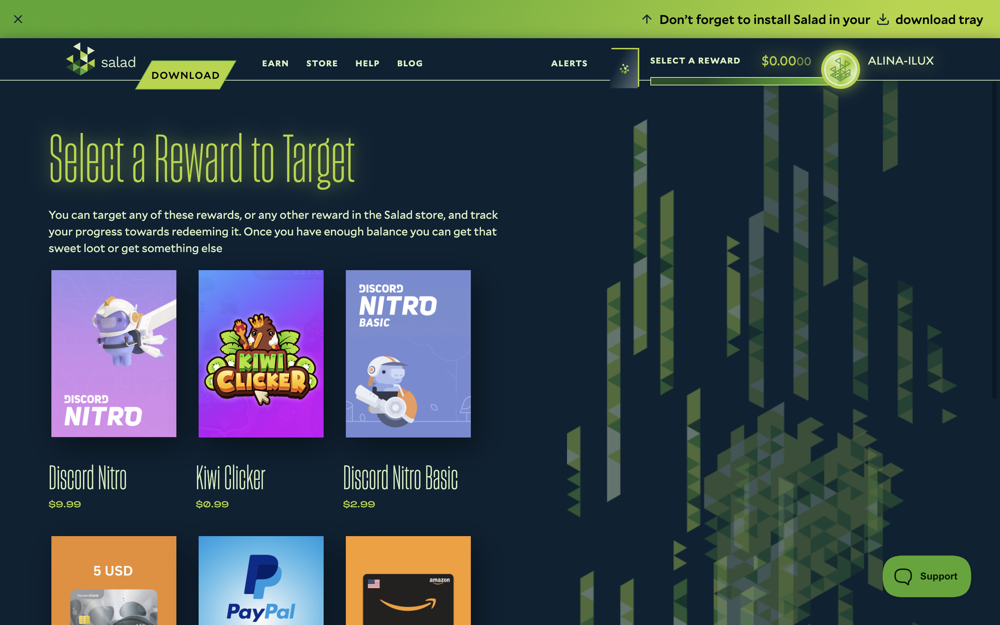
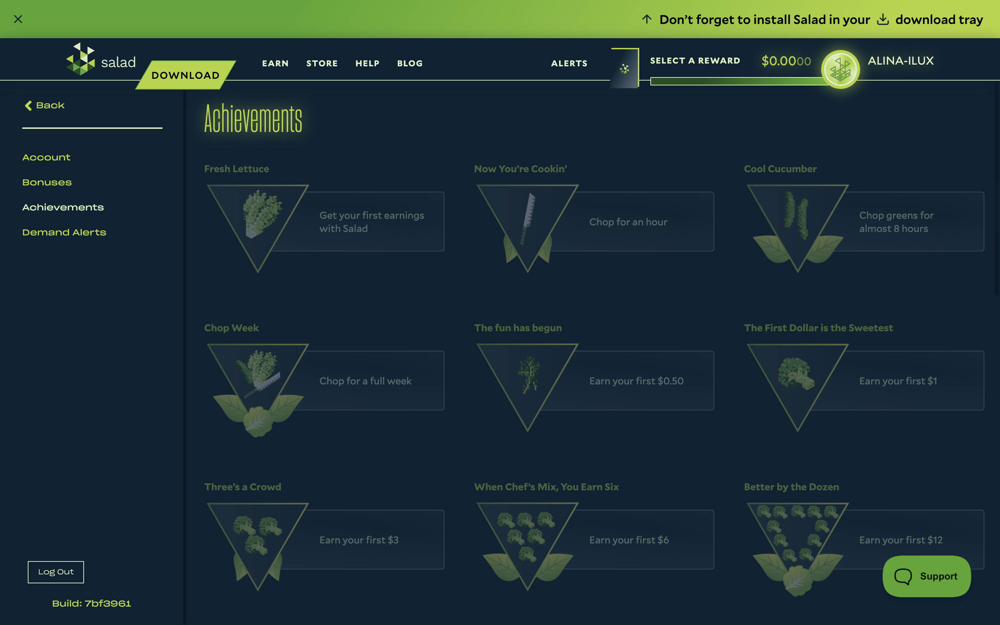
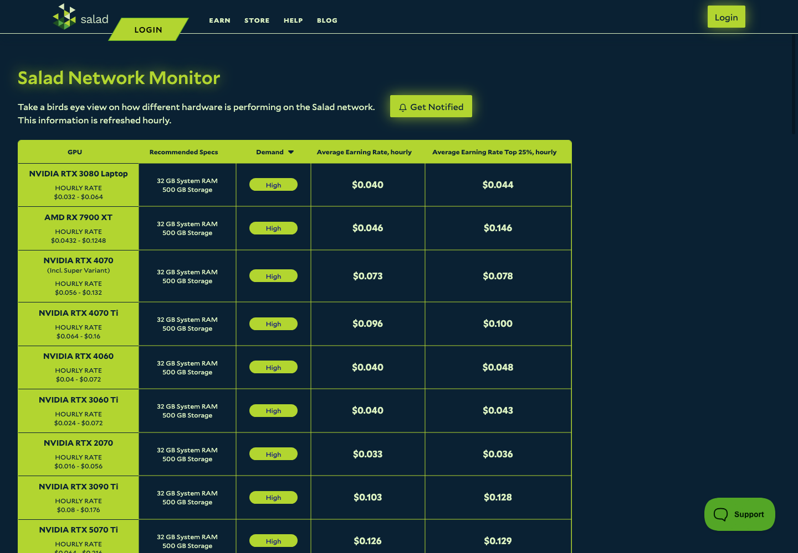
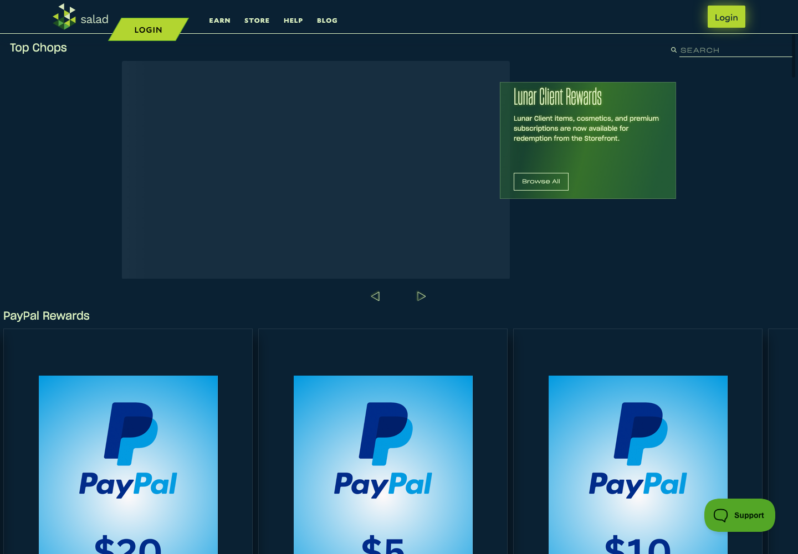

# Salad

Дата разбора: 2026-11-22. Разбор лендинга по NMT: [04-salad-landing-nmt.md](04-salad-landing-nmt.md).
Источники: веб-кабинет salad.com (вход тестовым аккаунтом, баланс $0), публичное API кабинета `app-api.salad.com`, открытый исходный код веб-интерфейса [SaladTechnologies/salad-applications](https://github.com/SaladTechnologies/salad-applications) (коммит от 2026-11-20), официальная справка support.salad.com.
Десктоп-приложение (Windows, 1.9.29) не запускали: Mac, а код нативной части закрыт. Поэтому экраны мастера настройки описаны по справке и лендингу и помечены **[не проверено]**.
Статусы: **[факт]** — видно в кабинете, API или коде; **[вывод]** — выведено из фактов; **[не проверено]** — со слов Salad, сами не видели.

Скриншоты: [`screenshots/salad/`](../screenshots/salad/)

---

## Резюме

1. **Онбординг разорван на две части: сайт и программа.** Аккаунт заводится в браузере (почта + одноразовый код), а вся настройка (антивирус, WSL, выбор типов работ, майнинг) происходит в Windows-программе. В веб-кабинете новичка не ведут никуда: пустые нули и одна плашка «Don't forget to install Salad». [факт]
2. **Прогресс отслеживается деньгами с точностью до сотой цента.** Баланс в шапке показан как `$0.0000`, рядом полоска прогресса до выбранной «целевой награды». Есть сводка заработка (24 ч / 7 / 30 дней), график по каждой машине, 23 ачивки и скрытая система уровней-овощей. [факт]
3. **Ощущение прогресса держится на «целевой награде».** Пользователь выбирает, на что копит (Discord Nitro, PayPal $5, Amazon $10), и видит полоску до неё. Это главный мотивационный механизм кабинета. [факт + вывод]
4. **Тратить можно только в собственном магазине, и почти всё с наценкой.** PayPal $5 стоит $5.99 баланса (+20%), Visa $100 — $115 (+15%). Чем меньше сумма вывода, тем больше наценка. Новичка ещё и не пускают выводить, пока не наберёт опыт: «This Salad account is too new to redeem». [факт]
5. **Благотворительность — шесть кнопок по $0.10–0.50.** Пожертвования идут 1:1 без наценки, но фиксированными мелкими суммами, без отчёта о том, куда ушли деньги. Это дальний угол магазина, а не часть продукта. [факт + вывод]
6. **Для нового пользователя со средней картой путь до первой награды — недели.** RTX 3060 по данным Salad в среднем приносит $0.034/ч. До минимального вывода (PayPal $5 = $5.99) это ~176 часов работы, то есть ~22 дня по 8 часов. [вывод из данных Network Monitor]

---

## Суть / модель

- Пользователь («Chef») ставит Windows-программу, которая в простое отдаёт мощность ПК. Работы бывают четырёх видов: контейнеры на GPU (самые доходные, «only newer NVIDIA GPUs»), контейнеры на CPU, раздача интернет-канала («streaming services») и майнинг криптовалюты («always available to chefs»). [факт, /earn]
- Salad перепродаёт мощность компаниям как SaladCloud. Пользователь получает не деньги, а **Salad Balance** — внутренний баланс, который тратится только в магазине Salad. [факт]
- Награды выдаёт сторонний сервис Tremendous (поле `source` у PayPal-награды: `Salad.Rewards.Providers.Tremendous...`). Пожертвования имеют `source: "Donation"`. [факт, API]

## Платформы и онбординг

### Путь новичка целиком

| # | Шаг | Где | Что видит пользователь | Статус |
|---|---|---|---|---|
| 1 | Лендинг /download | сайт | две кнопки «Download for NVIDIA / AMD». Не на Windows — «Send yourself the link» | [факт] |
| 2 | Установка | Windows | программа живёт в трее | [не проверено] |
| 3 | Вход | браузер | в программе «Log In» → открывается браузер → форма входа (см. экран 1) | [факт: форма] / [не проверено: переход из программы] |
| 4 | Код из письма | браузер | «Enter Your One-Time Login Code», 6 символов | [факт] |
| 5 | Мастер настройки | Windows | добавить Salad в исключения антивируса, поставить WSL, выбрать типы работ. Майнинг «presented during signup, enabled by default» | [не проверено, по справке и лендингу] |
| 6 | Chop Now | Windows | первая задача — короткая проверка совместимости, потом оплачиваемые. Можно включить Auto Start | [не проверено] |
| 7 | Кабинет | браузер | пустой Earning Summary с нулями | [факт] |

Справка честно называет требования для самых доходных работ: Windows 10/11, видеокарта из списка Network Monitor, **32 ГБ ОЗУ, 70 ГБ свободного места на C:, включённая виртуализация, интернет без VPN**. На лендинге требования мягче («12 GB of RAM»). [факт]

### Экран 1. Вход и регистрация — одна форма

- Текст: «Rewards inbound! Create a Salad account to earn from your idle PC. If you're returning to the Kitchen, enter the email you used to sign up.» — регистрация и вход в одной форме, отдельного «Sign up» нет. [факт]
- Обязательная галочка «I agree to the Terms of Service and Privacy Policy», без неё кнопка Submit неактивна. [факт]
- Поле Email → Submit → «Enter your email address to receive a one-time login code». Паролей нет. [факт]
- Альтернативы: «Sign in with Google», «Login With Passkey». [факт]
- Справа коллаж из логотипов наград: Visa, Discord Nitro, Minecraft, Bitskins, Steam, Amazon, Blizzard, Roblox, PlayStation. Обещание продаётся через знакомые бренды, а не через сумму. [факт + вывод]
- Внизу: «Known compatibility issues may prevent you from logging in with Brave». [факт]

### Экран 2. Код из письма

- «Enter Your One-Time Login Code / A verification code was sent to your email address …», ссылки «Send it again?» и «Enter the wrong email?». Код пришёл за ~1 минуту, 6 символов (буквы и цифры). [факт]
- Никнейм создаётся сам из почты (`alina-ilux` → «ALINA-ILUX» в шапке), его можно сменить в Account. [факт]

### Экран 3. Первый вход: пустой кабинет

- После кода сразу открывается Earning Summary. Ни приветствия, ни шагов, ни чек-листа. [факт]
- Единственная подсказка — зелёная плашка сверху «↑ Don't forget to install Salad in your ↓ download tray» (рассчитана на то, что установщик только что скачан из браузера). Плашку можно закрыть крестиком. [факт]
- Все метрики $0 и «0 hours», таблица машин и график — «No data to display». Пустые состояния не объясняют, что делать. [факт]
- Блок «Latest Rewards Redeemed»: «No rewards redeemed yet. Check out your reward progress on the top right of this screen» — подталкивает к целевой награде. [факт]
- Вывод: веб-кабинет предполагает, что человек пришёл из программы. Тот, кто зарегистрировался на сайте и не поставил программу (например, с Mac), застревает без объяснения, что ему делать дальше. [вывод]

## Как трекается прогресс

### Шапка — постоянно на виду
- Слева направо: **Alerts** · миниатюра целевой награды · «SELECT A REWARD» + **полоска прогресса** · **баланс `$0.0000`** (четыре знака после точки, последние два мельче) · аватар · ник. [факт]
- Четыре знака нужны, чтобы баланс заметно рос даже при заработке $0.03 в час: каждая сотая цента видна. [вывод]

### Целевая награда (главный механизм)

- Страница «Select a Reward to Target»: «You can target any of these rewards, or any other reward in the Salad store, and track your progress towards redeeming it.» [факт]
- Рекомендации для нового аккаунта (API `rewards/recommendations`): Discord Nitro $9.99, Kiwi Clicker $0.99, Discord Nitro Basic $2.99, Prepaid Mastercard $5 за $5.99, PayPal $5 за $5.99, Amazon $10 за $11.00. [факт]
- Любую награду в магазине можно сделать целью кнопкой «TARGET THIS REWARD». После выбора: «You've selected a reward! Start chopping with the Salad App to earn towards your reward!» [факт, код]
- За первую цель выдаётся ачивка «On Lock», за выкуп цели — «Target Acquired». [факт]

### Earning Summary (/earn/summary)
- Плитки: Current Balance, Lifetime Balance, Total Chopping Hours, Number of Rewards Redeemed, Earnings last 24 hours / 7 days / 30 days. [факт]
- **All Machines**: таблица Machine ID · Last Seen · Current Earning Rate. Можно открыть карточку машины. На одном аккаунте может быть несколько ПК, заработок суммируется. [факт]
- **Earning History**: график или таблица, за 24 часа / 7 / 30 дней, по каждой машине или суммарно. Сноска: «Per machine earnings don't include referral earnings, earning rate multipliers or any other kind of bonus earnings». [факт]
- Данные обновляются сервисом в фоне («Starting refresh service», «Started reward vault and balance refresh» в консоли). [факт]

### Опыт (XP) и уровни-овощи
- XP = минуты работы: ачивка «Chop for an hour» имеет id `_60Xp`, «Chop for a full week» — `_10080Xp` (60 × 24 × 7). API отдаёт `{"lifetimeXp":0}`. [факт]
- В коде 18 уровней-овощей: carrot → lettuce → tomato → cucumber → beet → spinach → mushroom → red-pepper → avocado → red-onion → olives → broccoli → blue-cheese → egg → apple → kale → eggplant → green-jello. Кривая подобрана так, чтобы все уровни заняли 131 400 XP («~91 days or 1 quarter of the year» — комментарий в коде). [факт, `modules/xp/models/defaultLevels.tsx`]

| Уровень | Нужно часов работы (накопительно) |
|---|---|
| 1 carrot | 1 |
| 3 tomato | 7 |
| 5 beet | 23 |
| 8 red-pepper | 95 |
| 10 red-onion | 209 |
| 13 blue-cheese | 574 |
| 15 apple | 1 024 |
| 18 green-jello | 2 190 (= 91 день без перерыва) |

- В веб-кабинете уровень нигде явно не показан (вероятно, его видно в десктоп-программе). [вывод, не проверено]
- **XP влияет на деньги**: сервер отклоняет вывод с ошибкой `redemptions:notEnoughXp` и текстом «This Salad account is too new to redeem. Please keep chopping with Salad and try again later.» Порог в коде не указан. Пользователя об этом заранее не предупреждают. [факт: код и тест]

### Ачивки (23 шт., /account/achievements)

Не полученные показаны тускло-зелёными треугольниками с овощами. [факт]

| Группа | Ачивки |
|---|---|
| Время работы | Now You're Cookin' (1 ч) · Cool Cucumber (~8 ч) · Chop Week (неделя) |
| Заработок | Fresh Lettuce (первый заработок) · $0.50 · $1 · $3 · $6 · $12 · $25 |
| Целевая награда | On Lock (выбрать цель) · Target Acquired (выкупить цель) |
| Выводы | 1-й · 2-й · 5-й · 10-й · 25-й вывод |
| Star Chef | 1 · 2 · 5 · 10 · 25 раз получить статус Star Chef |
| Бонусы | And a Little Something Extra (первый бонус) |

- Первые ачивки рассчитаны на маленькие шаги ($0.50, 1 час). Это заполняет первые дни, пока до вывода далеко. [вывод]
- Что такое «Star Chef» и как его получить, в кабинете не объяснено нигде. [факт]

### Бонусы, рефералы, уведомления
- **Bonuses** (/account/bonuses): у нового аккаунта пусто, «No unclaimed bonuses available». Бонус бывает предметом или множителем скорости заработка. Если взять новый множитель, всплывает «Replace Current Earning Rate? / Replace my current bonus / Keep my current bonus». [факт]
- **Рефералы**: по коду пригласивший получает 50% от заработка друга (до $1 с человека), друг — двойную скорость, пока не заработает $4. Но у нового аккаунта API отдаёт `"userReferralsEnabled": false` и раздел в меню не показан. Видимо, рефералку открывают не всем или не сразу. [факт + вывод]
- **Demand Alerts**: можно подписаться на письмо, когда спрос на нужную видеокарту вырастет. Для этого не обязателен аккаунт («Not yet a chef? No problem!»). [факт]
- **Network Monitor** (/earn/demand, публичный): таблица по ~50 видеокартам — спрос (High / Moderate / Low), диапазон «HOURLY RATE», средний заработок и средний заработок топ-25%. На 22.11 почти у всех карт стоит «High». [факт]
  - Цифры расходятся с лендингом. RTX 4090: Network Monitor — среднее **$0.281/ч**, топ-25% **$0.337**; виджет на /download — среднее $0.262, топ-1% **$0.476**. Разные выборки и окна, но для пользователя это два разных обещания. [факт]

## На что можно потратить заработанное

### Магазин (/store) — 15 разделов

Магазин открыт без входа. Цены указаны в Salad Balance (в долларах). [факт]

| Раздел | Что внутри (цена в балансе) |
|---|---|
| Top Chops (баннер) | Valorant, PayPal, Minecraft-хостинг, Xbox, Lunar Client, Amazon, Discord Nitro Basic, Steam |
| PayPal Rewards | $5 → $5.99 · $10 → $11.99 · $20 → $22.50 · $50 → $55.50 · $100 → $110.50 · $200 → $220 · $1 000 → $1 090 |
| Venmo | $5 → $5.99 · $10 → $11.50 · $50 → $55.50 · $100 → $110.50 · $200 → $220 |
| Prepaid VISA | $5 → $5.99 · $10 → $11.98 · $20 → $23.90 · $50 → $58 · $100 → $115 · $200 → $222 · $1 000 → $1 099 |
| Prepaid Mastercard | $5 → $5.99 · $10 → $11.99 · $20 → $23.99 · $50 → $59.99 · $100 → $115 · $200 → $229 |
| Most Popular | Discord Nitro $9.99, Amazon.com $10 → $11, Steam $20 → $23.99 (нет в наличии), Valorant $5 → $5.99 |
| Roblox | US $10 → $11.99, Canada $15 → $13.50, Europe €10 → $14 |
| Minecraft | Minecraft Java & Bedrock $29.99, косметика Lunar Client $3.50–20, хостинг $6.50–12 |
| International Amazon | .de/.fr/.it/.es €10 → $13, .co.jp, .ca, .com.au, .in, .se |
| Gaming Gift Cards | PlayStation $10 → $11, Nintendo $10 → $11, Twitch $15 → $16.99, LoL, Valorant, Xbox |
| **Donate your Balance** | POW! Protect Our Winters $0.50 · Extralife $0.10 · St Jude $0.10 · K9s for Warriors $0.10 · Turkish Red Crescent $0.10 · White Helmets $0.10 |
| Subscriptions | Discord Nitro $9.99 / Basic $2.99, Lunar+ $7.99, Hone Premium $5.99, Solo.to $4 (скидка −67%) |
| India / Germany / UK | региональные Amazon, Flipkart, Steam, Xbox, Deliveroo |

Ещё есть **RENDER** (криптотокен) на Solana-кошелёк и вывод на почту **Coinbase**. Цена RENDER считается котировкой в момент покупки. Предупреждение: «rewards sent to the wrong address cannot be recovered». [факт, код]

### Сколько стоит вывод (наценка)

| Вывод | Цена в балансе | Наценка |
|---|---|---|
| PayPal $5 | $5.99 | +20% |
| PayPal $20 | $22.50 | +12.5% |
| PayPal $100 | $110.50 | +10.5% |
| PayPal $1 000 | $1 090 | +9% |
| Visa $100 | $115 | +15% |
| Mastercard $50 | $59.99 | +20% |
| Пожертвование | $0.10 | 0% |

Самый маленький вывод деньгами стоит дороже всего, а именно его новичок сделает первым. На лендинге о наценке ничего нет. [факт + вывод]

### Правила вывода
- **Нужен опыт**: слишком новый аккаунт не может ничего купить («too new to redeem»). [факт, код]
- **Лимит**: не больше $1 000 баланса в сутки на человека, сброс в полночь UTC, включая пожертвования. [факт, справка]
- **Сгорание**: баланс сгорает после 12 месяцев без входа и без работы, восстановить нельзя. [факт, справка]
- **Возвратов нет**: на странице оплаты «Salad Plays for Keeps, No Refunds». Если поставщик отменил заказ, баланс возвращают («Order Canceled… we've refunded your Salad balance!»). [факт, код]
- **Цена может измениться в момент покупки**: «Uh-oh! The reward price has changed». Бывает «Out of Stock», «5 Remaining». [факт]
- **Дополнительные требования**: для Minecraft-наград нужен Minecraft username, для RENDER — Solana-кошелёк, для Coinbase — почта Coinbase. [факт]
- **Защита**: можно включить подтверждение покупок passkey'ем или резервным кодом («Protected Actions»). [факт]
- **Куда приходит**: код или ссылка — в **Reward Vault** (/store/vault) и на почту. [факт]
- **После покупки** просят оставить отзыв: «Congratulations on your reward! … Review us on TrustPilot». Отзыв просят в момент максимальной радости. [факт + вывод]

### Благотворительность внутри магазина
- Карточка пожертвования устроена как товар: «St Jude Children's Research Hospital - $0.10 Donation», кнопки «TARGET THIS REWARD» и «DONATE NOW», описание фонда в одну строку. [факт]
- Суммы фиксированы: $0.10 (пять фондов) и $0.50 (POW). Чтобы отдать $5, надо нажать «Donate» 50 раз. [факт + вывод]
- После пожертвования нет отчёта, сертификата, счётчика «вы помогли» — только запись в Reward Vault, как у любой покупки. [вывод по коду vault: общий список заказов]

## Мотивация и геймификация (сводно)

| Механика | Как работает | Сила |
|---|---|---|
| Баланс до 4 знаков | рост виден каждую минуту | сильная для первых дней |
| Целевая награда + полоска | «коплю на Nitro», видно, сколько осталось | главная |
| Ачивки за мелкие шаги | $0.50, 1 час, первая цель | заполняют паузу до вывода |
| Уровни-овощи (XP) | 18 уровней на ~91 день | в вебе не видны |
| Бонусы-множители | временно ускоряют заработок | у новичка пусто |
| Рефералы | 2× другу до $4, +50% себе до $1 | у новичка выключены |
| Demand Alerts | письмо, когда карта снова востребована | возвращает ушедших |
| TrustPilot после покупки | отзыв в пик радости | для роста, не для пользователя |

## Плюсы / минусы / наблюдения

**Плюсы**
- Целевая награда — простой и сильный способ превратить центы в понятную цель («ещё $3 до Nitro»). [вывод]
- Прозрачная статистика: по машинам, по часам, плюс публичный Network Monitor со спросом и диапазоном заработка. [факт]
- Вход без пароля (код на почту, Google, passkey) и защита покупок passkey'ем. [факт]
- Пожертвования без наценки. [факт]

**Минусы**
- Веб-кабинет новичка пустой и ничего не объясняет. Онбординг целиком живёт в Windows-программе. [факт]
- Скрытые условия вывода: наценка 9–20%, запрет для «слишком новых» аккаунтов без указания порога, сгорание через 12 месяцев. Ничего из этого нет на лендинге. [факт]
- Уровни и Star Chef в кабинете не объяснены, рефералка у новичка выключена — механики есть, но новичок их не видит. [факт + вывод]
- Цифры заработка на лендинге и в Network Monitor не совпадают. [факт]
- Благотворительность — шесть кнопок по 10 центов без обратной связи. [факт]

**Что взять нашему charity-продукту** [вывод]
1. **Целевая награда → «целевое доброе дело».** Не абстрактный счётчик, а конкретная цель с полоской: «ещё 3 часа — и одна вакцина / 10 обедов».
2. **Микропрогресс с первой минуты.** Четыре знака у баланса работают; нам нужен аналог в единицах пользы, который растёт на глазах.
3. **Первые ачивки — за то, что достижимо в первый день.** У Salad это 1 час и $0.50.
4. **Пустой кабинет — антипример.** После регистрации нужен экран «что дальше» и проверка, что программа поставлена и работает.
5. **Честность до регистрации.** Всё, что уменьшает результат (комиссии, пороги, сроки), показывать на лендинге, а не в справке.
6. **Обратная связь по пожертвованию.** Чего у Salad нет совсем: куда ушли деньги, что на них сделано, сколько всего собрали вместе.

## Сырые заметки
- Тестовый аккаунт: alina-ilux@proton.me, ник по умолчанию ALINA-ILUX, баланс $0, машин 0.
- API кабинета требует заголовок `X-XSRF-TOKEN` (любое значение) и куки сессии.
- API `notification-banner` до сих пор отдаёт баннер 2020–2021 года («newly redeemed reward codes are only available in your email inbox»), он просто не показывается по дате.
- Мусор в консоли у нового пользователя: `BalanceStore… Error: There is no machines`, 404 на `avatars/selected` и `bonuses/earning-rate`.
- В меню аккаунта: Account · Bonuses · Achievements · Demand Alerts · Log Out. Внизу «Build: 7bf3961».
- Не проверено (нужна Windows-машина): экраны мастера настройки, окно выбора типов работ и майнинга, как выглядит процесс chopping в трее, где показан уровень-овощ.
