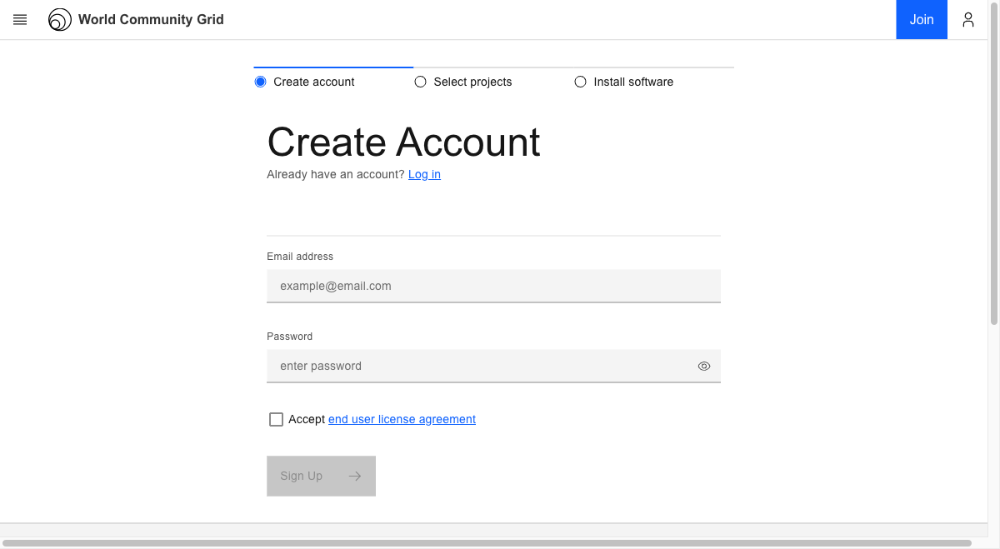
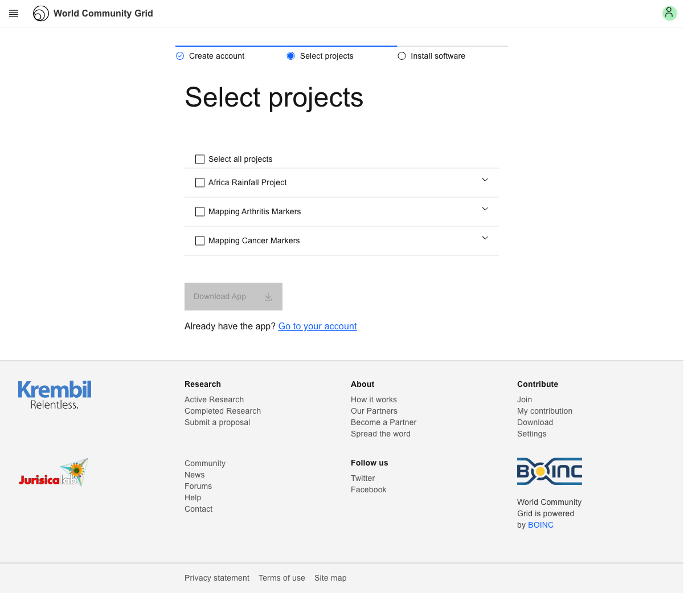
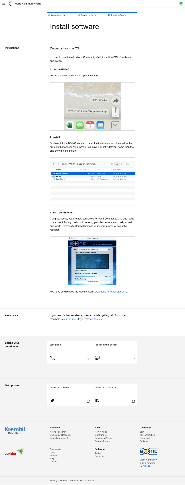
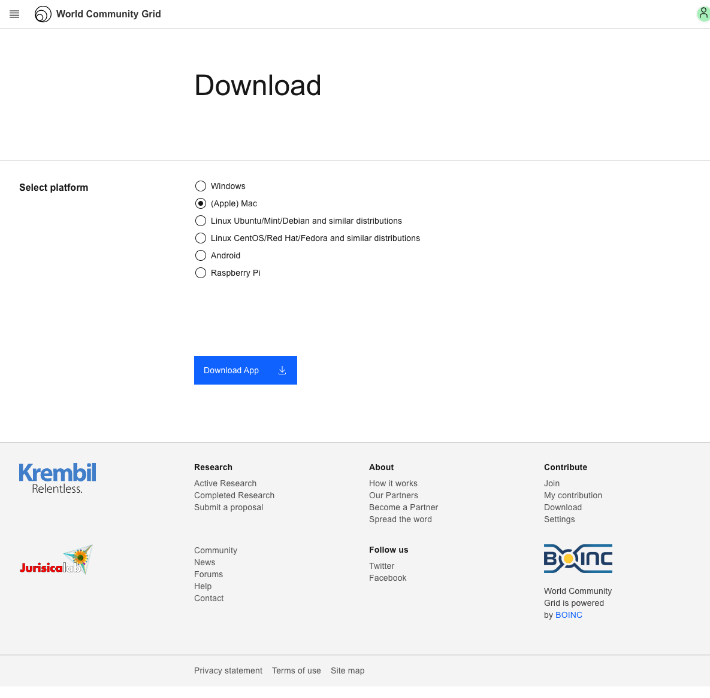
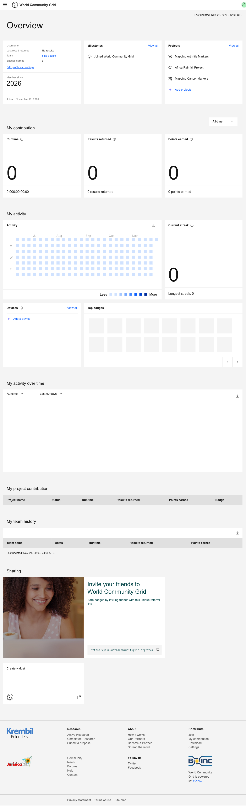

# World Community Grid / BOINC

## Суть / модель
- Волонтёр отдаёт простаивающие CPU/GPU под научные задачи (сейчас 3 проекта: Africa Rainfall, Mapping Arthritis Markers, Mapping Cancer Markers). Денег не платят ни волонтёру, ни фондам: награда в очках, бейджах и стриках. Проект ведёт Krembil Research Institute (Jurisica Lab), с 2021 года, до этого был IBM.
- Разбор лендинга по NMT: [05-wcg-boinc-landing-nmt.md](05-wcg-boinc-landing-nmt.md)

## Платформы и онбординг
Скриншоты: [`screenshots/wcg/`](../screenshots/wcg/). Аккаунт для разбора создан 2026-11-22 (userId 1187889). Пароль в репозиторий не кладём.

Путь Join, три шага со степпером: **Create account → Select projects → Install software**.

1. **Create account** — 
   - email, пароль и чекбокс EULA. Подтверждения пароля нет, входа через Google/Apple нет. Кнопка Sign Up неактивна, пока не отмечен EULA.
   - Клик по подписи чекбокса открывает Terms в новой вкладке, а сам чекбокс не ставит. Отметить можно только по самому квадратику.
   - После Sign Up сразу открывается шаг 2. Подтверждение email на этом этапе не требуется. [факт]
2. **Select projects** — 
   - «Select all projects» и 3 проекта, у каждого раскрывающееся описание. Пока ничего не выбрано, «Download App» неактивна.
   - Ниже ссылка «Already have the app? Go to your account».
3. **Install software** — 
   - Загрузка стартует сразу по нажатию «Download App». Платформа определяется автоматически (у нас macOS), выбрать её на этом шаге нельзя.
   - Инструкция из трёх шагов: Locate → Install → «Congratulations, you are now connected to World Community Grid». Внизу «Download for other platforms», «Join a team», «Install on more devices».
4. **/download** (после входа) — 
   - Выбор: Windows · Mac · Linux (Debian-подобные) · Linux (Fedora-подобные) · Android · Raspberry Pi. iOS нет.

## Какое приложение получает пользователь (проверено 2026-11-22)
**Обычный BOINC Manager от Berkeley без бренда WCG.** Это то же приложение, что мы видели на Linux у Charity Engine (`screenshots/charity-engine/linux-*`). Отличие от Charity Engine: под Windows CE ставит собственный брендированный клиент (charityengine.exe + VirtualBox), а WCG ставит стоковый BOINC.

| Платформа | Что отдаёт WCG | Как привязан аккаунт |
|---|---|---|
| Windows | `boinc_7.16.11_windows_x86_64__22_1187889_665c00d8.exe` (8,9 МБ), InstallShield. В ресурсах «BOINC», «Space Sciences Laboratory, U.C. Berkeley», «© 2020 University of California». Строк World Community Grid нет | userId и токен в **имени файла**, тот же приём, что у Charity Engine. Видимо, установщик по имени сразу подключает к WCG [вывод, не запускали] |
| Mac | `boinc_7.16.19_macOSX_universal.zip` (14,8 МБ), `edu.berkeley.boinc.Installer`, подписан 13.08.2021, скин только `Default`. Скрипт preinstall **удаляет старые скины «World Community Grid»** | Токен есть только в URL (`?userId=…&token=…`), в имени файла и внутри архива его нет. Значит, после установки проект, скорее всего, придётся добавлять вручную, а обещание «you are now connected» на Mac не сбывается [вывод, не запускали] |
| Linux | Пакет из репозитория дистрибутива (по справке) | вручную: Add project |
| Android | BOINC из Google Play | вручную |

- Брендированный клиент WCG в прошлом существовал: Windows/Mac, версия 7.14.2, скин «World Community Grid». Сейчас его не выдают, а Mac-установщик его скин подчищает.
- Версии старые: 7.16.11/7.16.19 (2020–2021), хотя у самого BOINC на boinc.berkeley.edu уже 8.2.11.
- Итого по интерфейсу: всё, что пользователь видит на компьютере, это стандартный BOINC Manager (простой/расширенный вид, космический фон, «Projects», «Suspend», «Notices»). Лицо WCG живёт только на сайте, в «My contribution».

## Интерфейс (экран за экраном)

### Личный кабинет: My contribution → Overview (пустое состояние)

Подменю: Overview · History · Projects · Team · Devices · Results · Milestones · Beta testing.
- **Профиль**: Username (у нового аккаунта пусто, имя не просили), Last result returned «No results», Team «Find a team», Badges earned 0, Member since 2026.
- **Milestones**: «Joined World Community Grid» — первая веха выдаётся сразу.
- **Projects**: три выбранных проекта и «Add projects».
- **My contribution** (All-time): три больших нуля — Runtime `0:000:00:00:00` (годы:дни:часы:мин:сек), Results returned, Points earned.
- **My activity**: тепловая карта по дням в стиле GitHub (Jul–Nov) и **Current streak / Longest streak**. Это единственная механика ежедневной привычки во всём сегменте.
- **Devices**: «Add a device». Пустое состояние не объясняет, что сначала надо установить и запустить BOINC.
- **Top badges**: 16 серых заглушек под бейджи.
- **My activity over time** (график, 90 дней), таблицы «My project contribution» и «My team history».
- **Sharing**: реферальная ссылка `join.worldcommunitygrid.org?recruiterId=…` («Earn badges by inviting friends») и «Create widget».
- Статистика обновляется с задержкой: «Last updated: Nov. 22, 2026 - 12:06 UTC», таблицы — «Nov. 21 23:59 UTC». Мгновенной обратной связи нет, как и у CE.

## Мотивация и геймификация
- Очки, бейджи за проекты и приглашения, вехи, стрики и тепловая карта активности, команды. Ни денег, ни розыгрыша (в отличие от CE с его $1000 jackpot).

## Плюсы / минусы / наблюдения
- (+) Регистрация легче, чем у CE: 2 поля и чекбокс против 5 полей и 3 переключателей.
- (+) Кабинет современный (IBM Carbon) и дашборд богаче: стрик, тепловая карта, вклад по проектам.
- (−) Приложение на компьютере чужое и безликое (стоковый BOINC), между «скачал» и «вижу вклад в кабинете» проходят часы.
- (−) На Mac, судя по всему, автоподключения нет, хотя на экране написано «you are now connected».
- (−) Новичку кабинет показывает одни нули без подсказки, что делать дальше.

## Сырые заметки
- TODO: в виртуалке CE-Ubuntu подключить WCG через Tools → Add project и снять экран с работающей задачей WCG, расширенный вид (Tasks/Statistics) и кабинет с ненулевыми цифрами.
