# Ecosia: первый запуск, регистрация, профиль и поиск (Android)

Билд: Ecosia 154.0.8037.126.54 (`com.ecosia.android`), XAPK с APKPure, подпись Ecosia GmbH сверена (см. [разбор APK](06-ecosia-apk-analysis.md)). Эмулятор Pixel 6a, Android 17, регион поиска определился как Bulgaria. Снято 2026-11-23, 01:21–01:30 (по локальному времени).
Скриншоты: [`screenshots/ecosia/`](../screenshots/ecosia/). Email тестового аккаунта на скринах закрыт серой плашкой.

## Схема
```
Запуск → 1–2. Welcome (видео, «Real change at your fingertips») → Get started
       → 3. Новая вкладка (гость): «Private by design», 2 тикающих счётчика, top sites
       → аватар → 4. Шторка гостя: Level 1 - Ecocurious, «Seeds symbolize your own impact» → Sign up
       → 5. Форма регистрации (веб, Custom Tab): Google / Apple / email + пароль
       → 6. Шторка аккаунта → Your profile
       → 7–12. Профиль (веб-страница ecosia.org/accounts/profile): уровень, семена, стрик,
               личный impact, коллекция, общий impact
       → 13–17. Поиск «trees planted yearly»: Web · AI · Images · Videos · News
```
Главное: **онбординг состоит из одного экрана.** Ни разрешений, ни выбора поисковика, ни предложения сделать браузер браузером по умолчанию на первом запуске не было: сразу рабочая новая вкладка. Регистрация необязательна, профиль и семена продаются из шторки по аватару.

---

## 1–2. Welcome
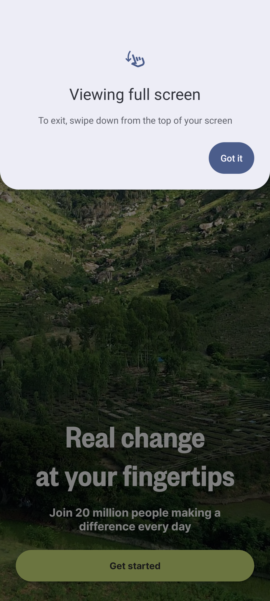 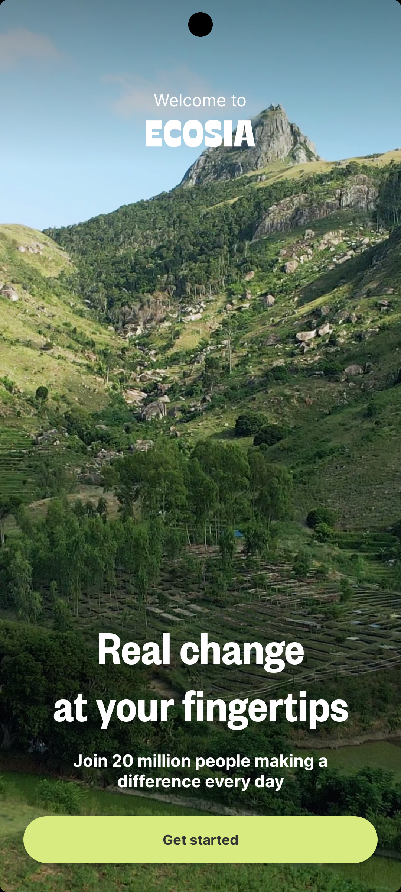

- Полноэкранное **видео** с питомником и посадками на склоне (ролик вшит в APK). Сверху «Welcome to ECOSIA».
- Заголовок **«Real change at your fingertips»**, подзаголовок «Join 20 million people making a difference every day». Те же «20 million», что в финале лендинга.
- Одна кнопка **Get started** (салатовая). Ни «Skip», ни ссылок на условия, ни чекбоксов.
- Плашка «Viewing full screen» на скрине 1 системная (Android, immersive mode), не часть приложения.
- По коду за этим экраном могли идти «Welcome to … Sign in / Maybe later» и промо «браузер по умолчанию» ([APK, §3](06-ecosia-apk-analysis.md)), но в этом прогоне их не было. Видимо, они управляются флагами или показываются позже.

## 3. Новая вкладка (гость)
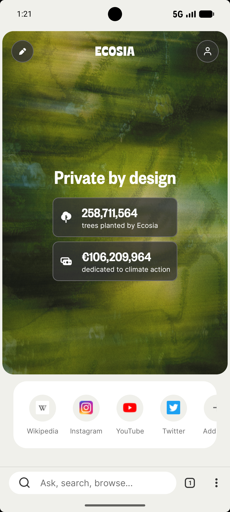

Сверху вниз:
1. **Хедер-карточка** с размытым зелёным фоном: карандаш (настроить новую вкладку), логотип ECOSIA, аватар (профиль).
2. **«Private by design»** — тот же заголовок, что на лендинге. В APK это ротируемый заголовок с CDN, то есть его можно менять удалённо.
3. **Два счётчика**: «258,711,564 trees planted by Ecosia» и «€106,209,964 dedicated to climate action». Числа **тикают в реальном времени**: через 13 секунд на скрине 4 уже 258,711,570 и €106,209,971. Это клиентская экстраполяция по скорости из API.
4. **Top sites**: Wikipedia, Instagram, YouTube, Twitter, Add.
5. **Нижний тулбар**: поле «Ask, search, browse…», счётчик вкладок, меню ⋮. Адресная строка внизу, как в новых версиях Chrome.
- Личного счётчика поисков гостя («Searches in … plant trees!») ещё нет: он появляется после первого поиска.

## 4. Шторка гостя
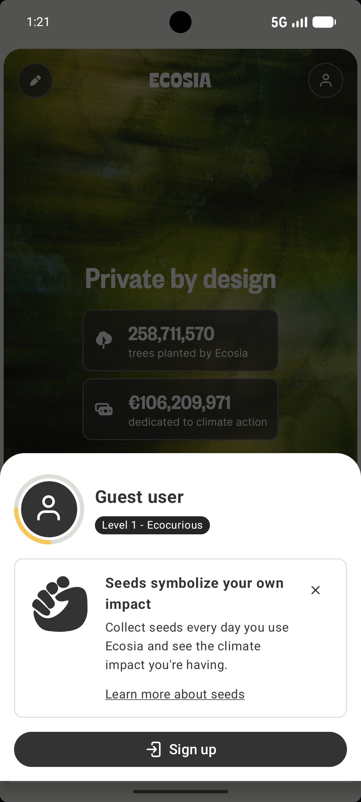

- **Guest user** и бейдж **«Level 1 - Ecocurious»**. Вокруг аватара кольцо прогресса с жёлтой дугой: гость уже «на пути» к следующему уровню.
- Карточка-объяснение (закрывается крестиком): **«Seeds symbolize your own impact. Collect seeds every day you use Ecosia and see the climate impact you're having.»** + «Learn more about seeds».
- Одна основная кнопка **Sign up**. Отдельного Sign in в шторке нет (есть внутри формы).
- Приём тот же, что у Grass: геймификация (уровень, прогресс) показана до регистрации, а аккаунт подаётся как способ её «включить».

## 5. Регистрация
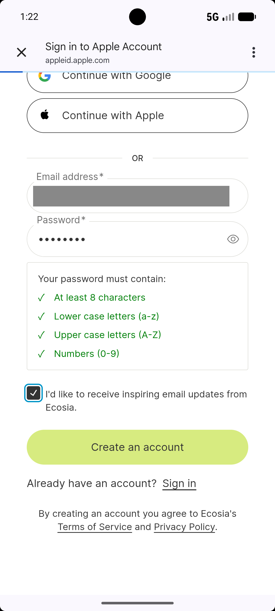

- Веб-форма в **Custom Tab** (браузерная вкладка поверх приложения), не нативный экран.
- **Continue with Google**, **Continue with Apple**, или email + пароль.
- Требования к паролю — **живой чек-лист** (8 символов, строчные, заглавные, цифры), пункты зеленеют по мере ввода.
- Чекбокс **«I'd like to receive inspiring email updates from Ecosia.»** на скрине отмечен. Стоит он по умолчанию или его поставил пользователь, по скрину не видно, нужно проверить. Если по умолчанию, это тёмный паттерн, как сотовая связь у Grass.
- Согласие с Terms и Privacy **без чекбокса**: «By creating an account you agree to Ecosia's Terms of Service and Privacy Policy.»
- **Баг шапки**: Custom Tab показывает «Sign in to Apple Account · appleid.apple.com», хотя на экране форма Ecosia. Видимо, перед этим нажимали «Continue with Apple» и вернулись назад, а заголовок не обновился. Для пользователя это выглядит как ввод пароля на чужом сайте.
- От формы (01:22) до шторки с аккаунтом (01:25) прошло около 3 минут. Было ли подтверждение email, по скринам не видно.

## 6. Шторка аккаунта
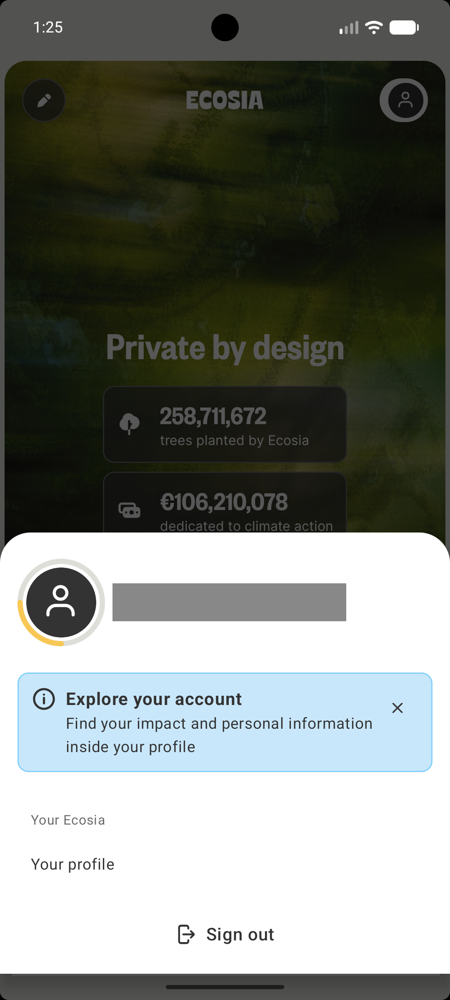

- Вместо имени **email** (имя при регистрации не спрашивали).
- Хинт **«Explore your account — Find your impact and personal information inside your profile»** (закрывается). Это одноразовая подсказка `ecosia_ntp_account_explore_hint`.
- Меню: Your Ecosia → **Your profile**; внизу **Sign out**.
- Бейджа уровня и кнопок рефералки в шторке нет.

## 7–12. Профиль (веб-страница `ecosia.org/accounts/profile`)
Профиль — **не нативный экран, а сайт**, открытый во вкладке браузера (в адресной строке `ecosia.org/accounts/profile`). Приложение только даёт вход в него.

### 7. Шапка и уровень
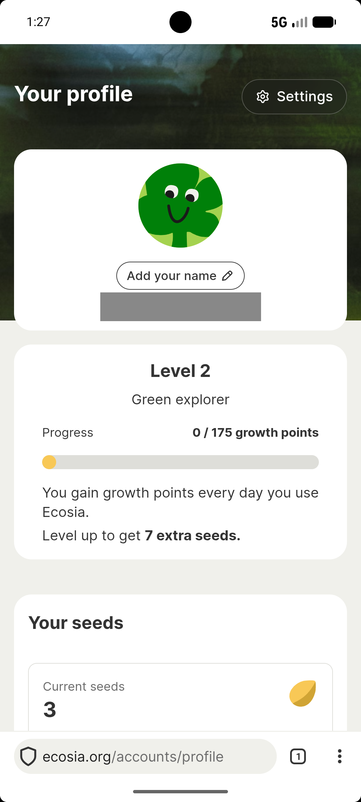

- Аватар-маскот (зелёный лист-клевер с лицом), «Add your name ✎», email, кнопка **Settings**.
- **Level 2 — Green explorer.** Сразу после регистрации уровень **поднялся с 1 до 2**: гость был Level 1 Ecocurious. Это награда за регистрацию.
- Progress **0 / 175 growth points**. «You gain growth points every day you use Ecosia. **Level up to get 7 extra seeds.**»

### 8. Семена и стрик
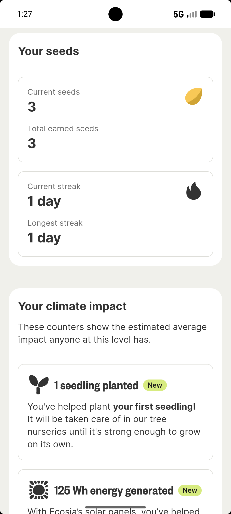

- **Your seeds**: Current seeds 3, Total earned seeds 3. Есть баланс и сумма за всё время, значит семена можно тратить [вывод; на что, в UI не видно].
- **Current streak 1 day / Longest streak 1 day** с иконкой огня. Стрик есть, как у WCG; в коде приложения его не было, потому что он живёт на сайте.

### 9. Личный climate impact
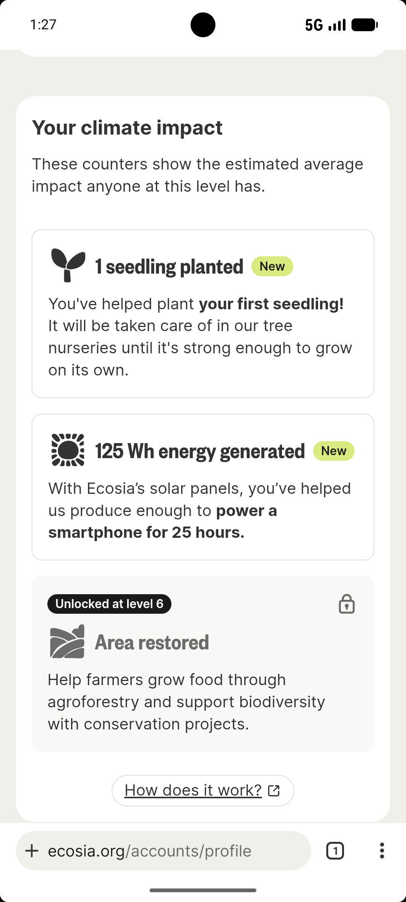

- Подзаголовок честно говорит: **«These counters show the estimated average impact anyone at this level has.»** Личный impact — это оценка по уровню, а не подсчёт собственных действий (то же, что в справке, см. [лендинг NMT](06-ecosia-landing-nmt.md)).
- **1 seedling planted** (New): «You've helped plant your first seedling! It will be taken care of in our tree nurseries until it's strong enough to grow on its own.» Первое «дерево» выдаётся сразу, это саженец в питомнике.
- **125 Wh energy generated** (New): «…enough to power a smartphone for 25 hours». Перевод в бытовую единицу.
- **Area restored — Unlocked at level 6** (замок): «Help farmers grow food through agroforestry…». Следующая метрика заперта уровнем, это мотивация расти.
- «How does it work? ↗».

### 10. Коллекция
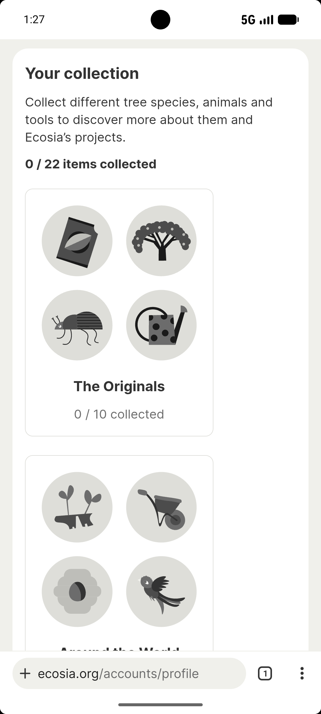

- **«Your collection»: «Collect different tree species, animals and tools to discover more about them and Ecosia's projects.» 0 / 22 items collected.**
- Наборы: **The Originals** (0/10: пакет семян, дерево, жук, лейка), **Around the World** (росток, тачка, улей/семя, птица) и далее. Иконки серые, пока не собраны.
- Механика коллекционирования (как бейджи у WCG, но с сюжетом про проекты). Как получать предметы, на экране не сказано. Возможно, за семена [гипотеза].

### 11–12. Общий impact
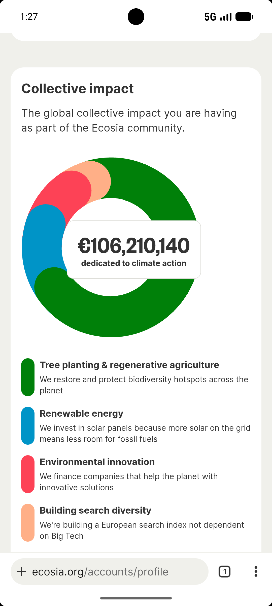 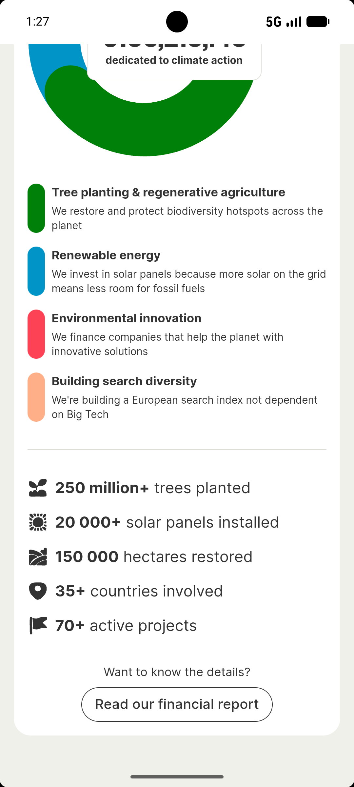

- «Collective impact — The global collective impact you are having as part of the Ecosia community.»
- Кольцевая диаграмма вокруг **€106,210,140 dedicated to climate action**: Tree planting & regenerative agriculture (большая часть) · Renewable energy · Environmental innovation · **Building search diversity** («We're building a European search index not dependent on Big Tech»). Четвёртое направление на лендинге не упоминалось.
- Цифры: **250 million+** trees planted · **20 000+** solar panels · **150 000** hectares restored · **35+** countries · **70+** active projects.
- «Want to know the details? **Read our financial report**».

## 13–17. Поиск
Запрос: «trees planted yearly».

### 13. Web
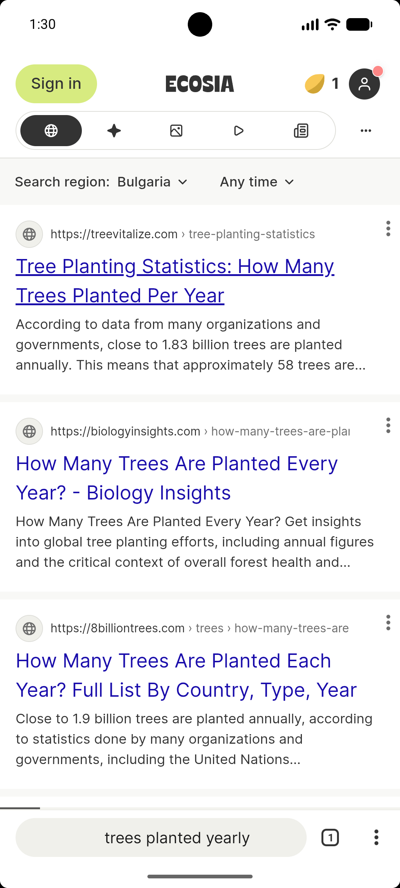

- Шапка выдачи: **«Sign in»** (салатовая) · ECOSIA · **🌰 1** (счётчик семян) · аватар с красной точкой.
- **Сессии приложения и сайта не связаны.** В приложении пользователь вошёл (в профиле 3 семени), а сайт в той же вкладке показывает гостя: кнопка «Sign in» и **1** семя. Пользователь видит два разных баланса. [факт; почему так, по коду не ясно: вход сделан через Auth0 в Custom Tab, а куки выдачи свои]
- Вкладки: Web · **AI (✦)** · Images · Videos · News · ⋯. Search region: Bulgaria, Any time.
- Обычная выдача, ссылки синие, формат классический.

### 14. AI chat
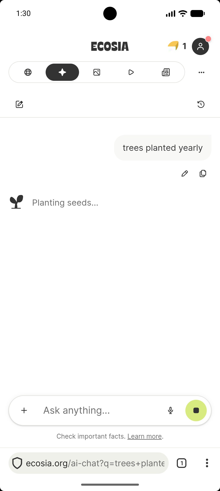

- Вкладка ✦ открывает `ecosia.org/ai-chat?q=…`, запрос подставляется как первое сообщение.
- Лоадер **«Planting seeds…»** с иконкой ростка. Ожидание оформлено в метафору бренда.
- «Ask anything…», «+» (вложения), микрофон, кнопка стоп. Внизу «Check important facts. Learn more.» Сверху новая беседа и история.
- Чат запустился, хотя сайт считает пользователя гостем. Значит, базовый AI-чат доступен без входа, а вход нужен для расширенных режимов (по строкам APK: Think longer, Generate images и т.д.).

### 15–16. Videos и Images
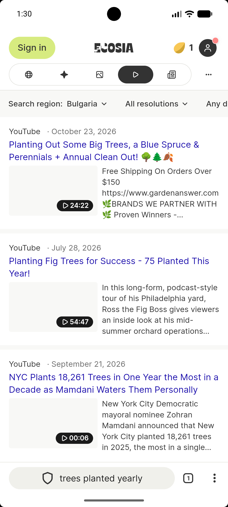 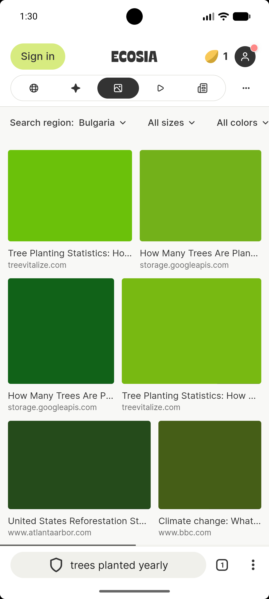

- Videos: результаты YouTube с датой и длительностью, **превью не загрузились** (серые плашки). Логотип ECOSIA на скрине 15 «рассыпается»: анимация загрузки.
- Images: вместо картинок **цветные плейсхолдеры** (доминантный цвет картинки). На момент скрина сами картинки ещё не подгрузились: долго на эмуляторе или ленивая загрузка.

### 17. News — пустое состояние
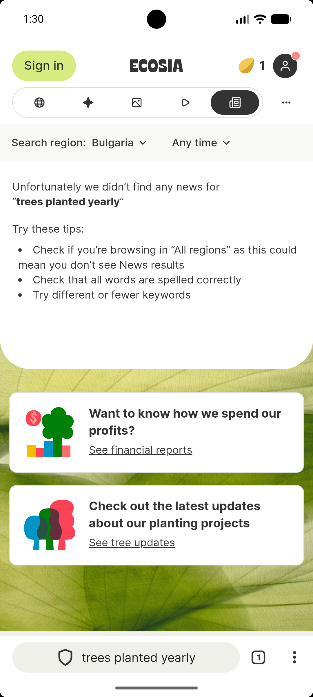

- «Unfortunately we didn't find any news for "trees planted yearly"» + советы (регион «All regions», орфография, меньше слов).
- **Пустое состояние используется для бренда**: две карточки, «Want to know how we spend our profits? **See financial reports**» и «Check out the latest updates about our planting projects. **See tree updates**», на фоне листа.

---

## Наблюдения по пути пользователя
- **Минимальный онбординг**: один экран с видео, дальше сразу рабочая новая вкладка. Короче, чем у всех разобранных (у Grass были разрешения + T&C, у WCG три шага).
- **Ценность видна до регистрации**: тикающие глобальные счётчики, уровень «Ecocurious» и кольцо прогресса у гостя. Регистрация **сразу награждается** переходом на Level 2, первым саженцем и 125 Wh.
- **Геймификация богаче, чем видно из приложения**: уровни, growth points, семена (баланс и всего), **стрик**, **коллекция из 22 предметов**, метрики, открывающиеся по уровням (Area restored на 6-м). Почти всё живёт на сайте, приложение лишь окно к нему.
- **Честная формулировка личного вклада**: «estimated average impact anyone at this level has». Это прозрачно, но обесценивает «мой» вклад: impact зависит от уровня (от дней использования), а не от количества поисков.
- **Разрыв между приложением и сайтом**: профиль — веб-страница, а выдача не видит входа в приложение (Sign in + 1 семя против 3 в профиле). Это самая заметная поломка опыта.
- **Регистрация**: удобная (Google/Apple, живая валидация пароля), но маркетинговый чекбокс отмечен (по умолчанию или нет — проверить), а шапка Custom Tab показывала «Apple Account» над формой Ecosia.
- **Бренд в мелочах**: «Planting seeds…» вместо спиннера, пустая выдача новостей ведёт на финотчёты и новости проектов.
---

# Второй заход (01:40–01:51): браузер по умолчанию, блокировщик, AI, настройки

К началу захода **приложение снова показывало гостя** (скрин 20: Guest user, Level 1 - Ecocurious, Sign up), хотя в 01:25 вход был выполнен.

**Баг входа (воспроизведён, logcat, 02:03).** Если нажать Sign up, Custom Tab с login.ecosia.org мгновенно открывается и закрывается: веб-сессия Auth0 ещё жива, и вход проходит без формы. Дальше в логе:
```
AuthViewModel: login succeeded – saving credentials
AuthViewModel: Cannot perform SSO exchange – stored credentials have no refresh token
AuthViewModel: session transfer failed (...) – logging out natively to avoid out-of-sync state
AuthViewModel: fetchImpact() failed – No Credentials were previously set.
```
Значит, приложение получает токены **без refresh token**, не может сохранить сессию и **само себя разлогинивает**. Для пользователя кнопка Sign up «ничего не делает», а приложение остаётся в гостевом режиме. Видимо, это же объясняет потерю входа после первой регистрации: без refresh token сессия не переживает истечения access token. Обход: очистить cookies в браузере (Delete browsing data → All time), тогда снова появляется полная форма входа с паролем. Баг в версии 154, исправлен ли он в 156, не проверяли.

## 18–19. «Make Ecosia default»
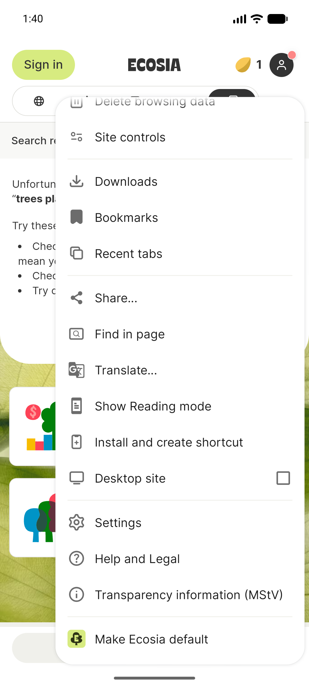 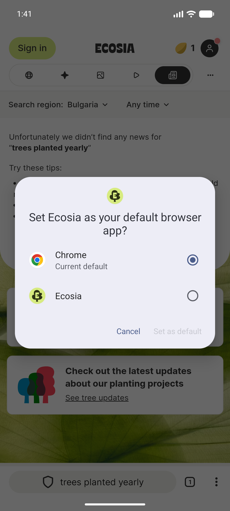

- Меню ⋮ — это стоковое меню Chrome (New tab, Incognito, History, Delete browsing data, Downloads, Bookmarks, Share, Translate…). Внизу три пункта Ecosia: **Help and Legal**, **Transparency information (MStV)**, **Make Ecosia default** (с логотипом).
- «Make Ecosia default» открывает **системный диалог Android** «Set Ecosia as your default browser app?» (Chrome — Current default / Ecosia). Своего экрана с объяснением «зачем» (строки про «help us plant more trees» есть в APK) не было. Диалог сразу системный.
- После выбора **никакой реакции**: ни «спасибо», ни бонусных семян, ни анимации. Пользователь возвращается на ту же страницу. Пункт «Make Ecosia default» из меню исчез, а иконка слева в адресной строке стала логотипом Ecosia.
- Ни на первом запуске, ни потом **промо-карточка «браузер по умолчанию» на новой вкладке не появилась**. Для поисковика это главное действие, но его никто не продаёт: оно спрятано в самый низ меню.

## 21–22. Настройки
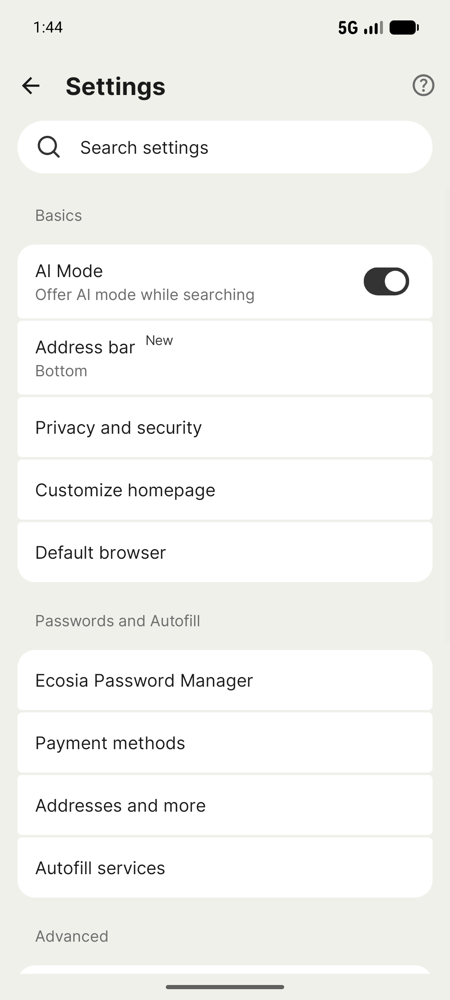 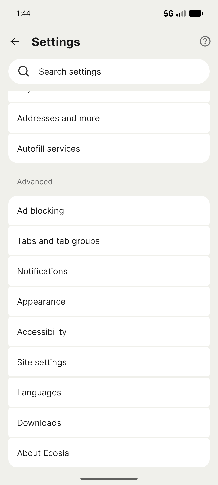

- Basics: **AI Mode** («Offer AI mode while searching») · Address bar (**Bottom**, «New») · Privacy and security · Customize homepage · Default browser.
- Passwords and Autofill: Ecosia Password Manager, Payment methods, Addresses and more, Autofill services.
- Advanced: **Ad blocking** · Tabs and tab groups · Notifications · Appearance · Accessibility · Site settings · Languages · Downloads · About Ecosia.
- **Нет** пунктов «Invite friends», «Rate app», «Feedback», хотя строки и ключи для них есть в APK (`wl_ecosia_prefs_rate_app`, `wl_ecosia_prefs_feedback`). Видимо, скрыты флагами. Нет и пункта про аккаунт или impact: они живут только в шторке по аватару.

## 23–25. Блокировщик рекламы
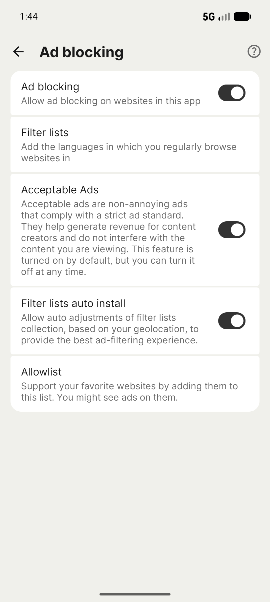  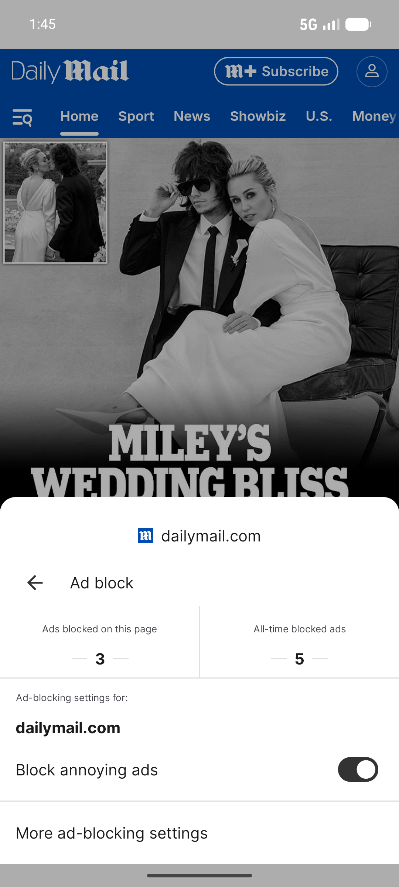

- Settings → Ad blocking: **Ad blocking** ✓ · Filter lists · **Acceptable Ads ✓** («This feature is turned on by default, but you can turn it off at any time.») · **Filter lists auto install ✓** («based on your geolocation») · Allowlist («Support your favorite websites… You might see ads on them»). **Все три тумблера включены по умолчанию.** Факт из APK подтверждён.
- На dailymail.com иконка замка слева от адреса превращается в **щит**. По тапу открывается стандартная панель сайта Chrome (Connection is secure, Cookies, Permissions) с добавленной строкой **«Ad block — 3 ads blocked on this page»**.
- Панель Ad block: «Ads blocked on this page **3**» и «All-time blocked ads **5**», тумблер «Block annoying ads» для сайта, «More ad-blocking settings».
- Счётчик заблокированного есть, но **он нигде не связан с деревьями или impact**. Это отдельная метрика «приватности», в профиль она не попадает.
- По пути сайт попросил разрешение на уведомления, Chrome показал стандартный запрос (Block / Allow).

## 26–29. AI как гость
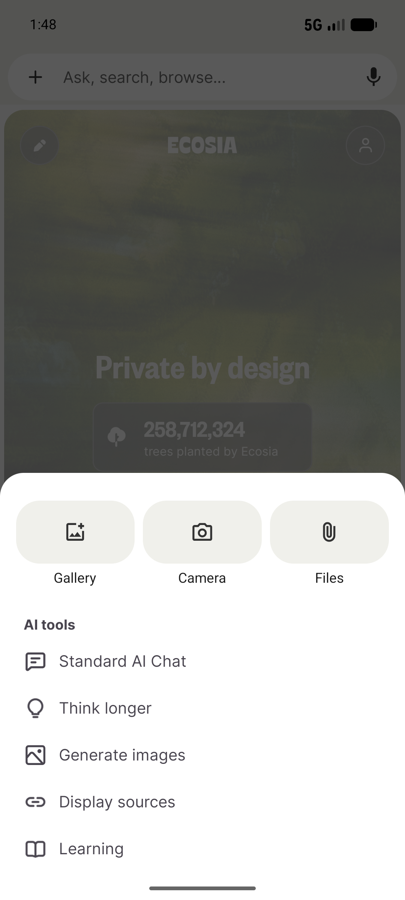 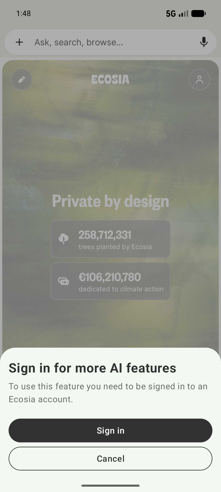 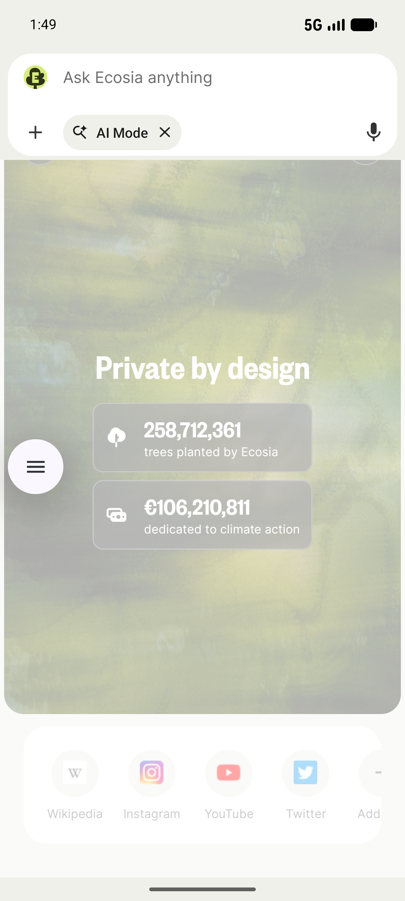 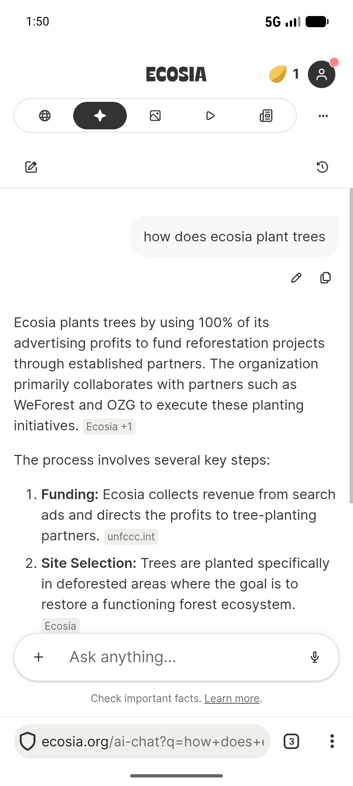

- В поле поиска кнопка **«+»** открывает шторку: вложения (Gallery, Camera, Files) и **AI tools**: Standard AI Chat · Think longer · Generate images · Display sources · Learning.
- Гостю доступен **только Standard AI Chat**. Think longer, Generate images, Display sources и Learning открывают шторку **«Sign in for more AI features — To use this feature you need to be signed in to an Ecosia account.»** (Sign in / Cancel). Проверено по каждому пункту.
- Standard AI Chat включает в поле чип **«AI Mode ✕»**, плейсхолдер меняется на «Ask Ecosia anything».
- Ответ открывается **на сайте** `ecosia.org/ai-chat?q=…`, а не нативно: структурированный ответ с номерами шагов и **чипами источников** (Ecosia +1, unfccc.int). На вопрос «how does ecosia plant trees» ответ рекламирует саму Ecosia («uses 100% of its advertising profits… partners such as WeForest and OZG»).
- AI — единственная функция, где вход **жёстко** требуется. Это главный рычаг регистрации (подтверждает вывод из APK).

## 30. Новая вкладка после нескольких поисков
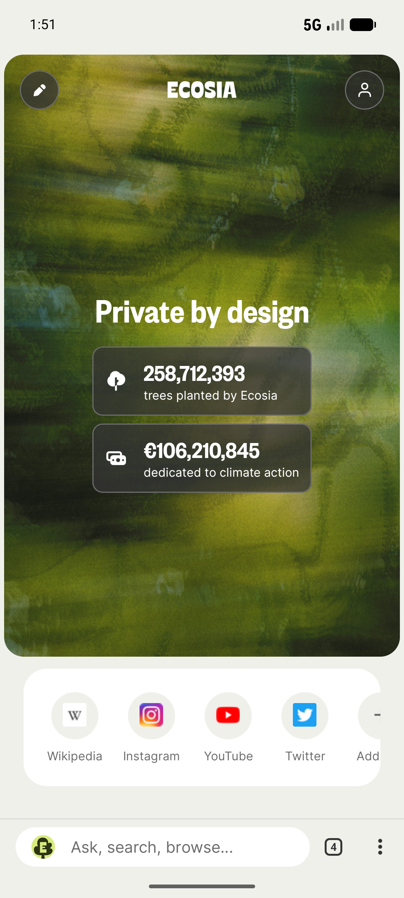

- После 3+ поисков (web, AI, ещё один web) новая вкладка **не изменилась**: только «Private by design» и глобальные счётчики. **Личного счётчика поисков** («Searches in Ecosia plant trees!») и карточки первого поиска не появилось, хотя строки есть в APK. Видимо, выключены флагом или требуют аккаунта.
- Счётчик семян есть только на сайте выдачи (🌰 1), в самом приложении его не видно.

---

# Третий заход (02:05–02:12): с аккаунтом

Вход: после очистки cookies открылась полная форма login.ecosia.org (email + пароль, Forgot password?). На этот раз в логе `fetchImpact() success – seeds=3, level=2` и **`session transfer succeeded`**: приложение передало сессию сайту через куку session transfer token, и сайт впервые «увидел» вход.

## 31–32. Новая вкладка и шторка с аккаунтом
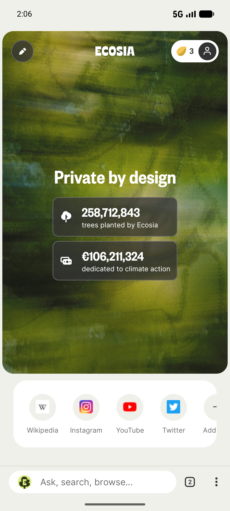 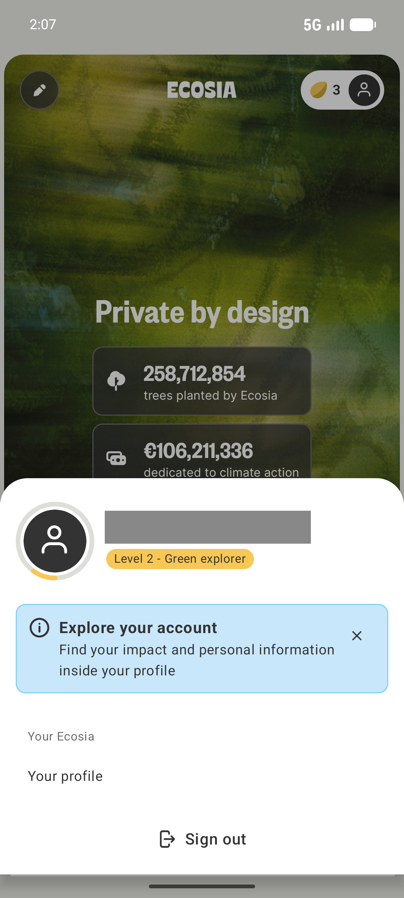

- В шапке новой вкладки рядом с аватаром появилась **плашка 🌰 3** — баланс семян. Гостю её не показывали. Других изменений на новой вкладке нет (ни личного счётчика поисков, ни рефералки).
- Шторка: email, бейдж **«Level 2 - Green explorer»** (жёлтый), хинт «Explore your account», Your profile, Sign out. **Пункта «Invite friends» нет.**

## 33. Настройки аккаунта (веб)
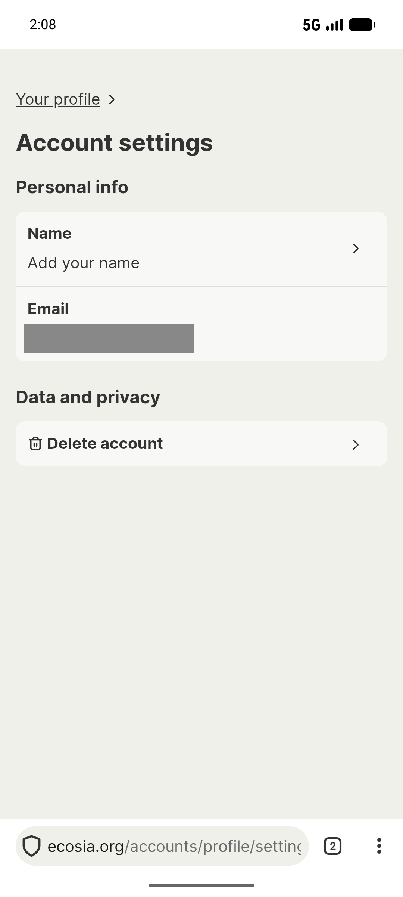

- `ecosia.org/accounts/profile/settings`: Personal info (Name — «Add your name», Email) и Data and privacy → **Delete account**. Удалить аккаунт можно в два клика, хорошо.
- Тумблера рассылки здесь **нет**: от маркетинговых писем, на которые согласились при регистрации, отписаться из профиля нельзя (видимо, только по ссылке в письме).
- В URL есть параметр `?_sp=<uuid>` — идентификатор Snowplow, который приложение передаёт сайту, чтобы склеить аналитику приложения и веба.

## 34–36. Think longer и запоздалый level-up
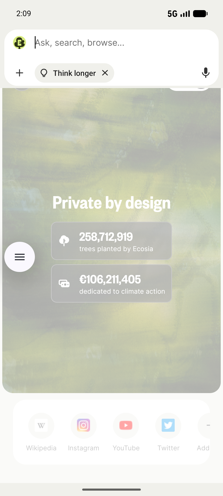 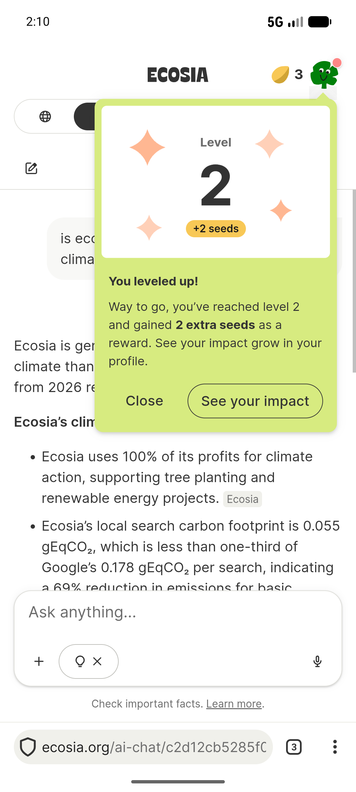 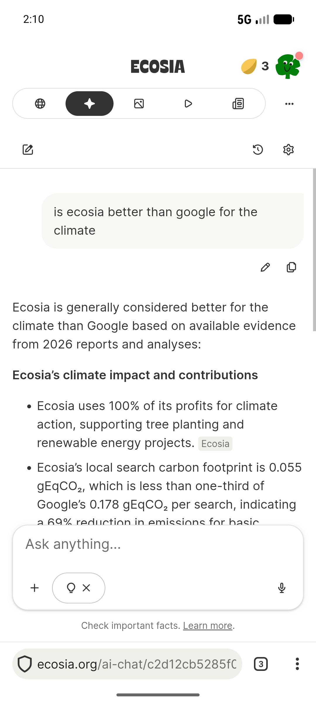

- С аккаунтом **Think longer** включается без шторки входа: в поле появляется чип «💡 Think longer ✕».
- Вопрос «is ecosia better than google for the climate» → развёрнутый ответ с разделами и чипами источников. Ответ, ожидаемо, в пользу Ecosia (сравнивает углеродный след запроса 0.055 и 0.178 gEqCO₂).
- **Поп-ап «You leveled up!»**: «Level 2 · +2 seeds · Way to go, you've reached level 2 and gained 2 extra seeds as a reward. See your impact grow in your profile.» (Close / See your impact). Конфетти-звёздочки, салатовая карточка от аватара.
- Поп-ап пришёл **через 45 минут после того, как уровень был получен** (регистрация в 01:25), и только когда сайт впервые увидел вход. Из-за бага с сессией награда за регистрацию до пользователя не доходила.
- Шапка сайта теперь синхронна с приложением: 🌰 3 и аватар-маскот вместо «Sign in» и «1».

## 37–38. Настройки AI-чата и генерация картинок
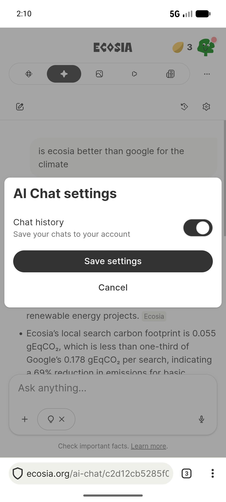 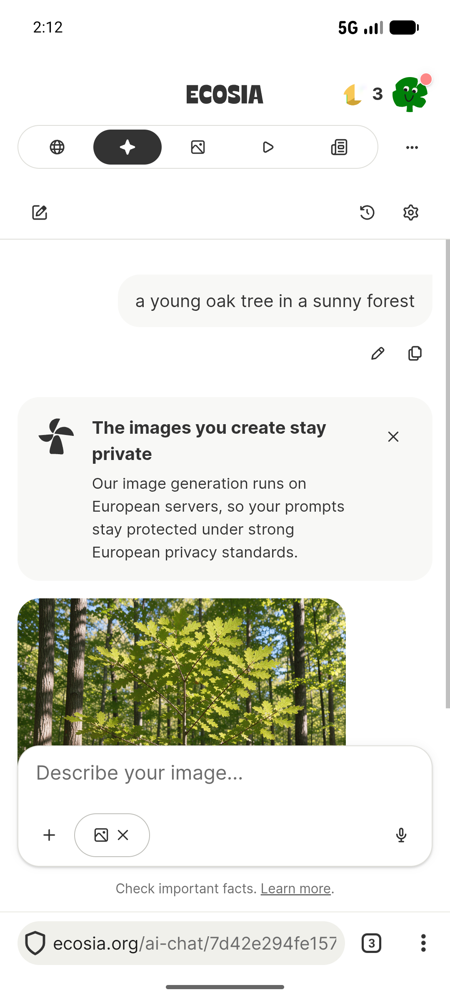

- Для аккаунта появилась шестерёнка **AI Chat settings**: единственная опция **«Chat history — Save your chats to your account»**, по умолчанию **выключена**. Приватность по умолчанию, в отличие от Acceptable Ads.
- **Generate images** («Describe your image…»): по запросу «a young oak tree in a sunny forest» картинка сгенерирована примерно за 30 секунд. Над ней карточка **«The images you create stay private — Our image generation runs on European servers, so your prompts stay protected under strong European privacy standards.»** Под картинкой Share, Download, оценка ответа.
- В AI-чате приватность продаётся на каждом шаге: «European servers», история выключена, картинки «private».

## Рефералка: на Android её нет
- Входа в «Growing together» не нашлось **нигде**, даже с аккаунтом: ни в шторке, ни в меню, ни в настройках приложения, ни на веб-странице профиля, ни на новой вкладке. Экран `ReferralsActivity` закрыт для запуска извне.
- В APK ссылка на справку называется `refer-a-friend-ios-only`, а в шагах «How it works» есть пометка «(iOS only)». Вывод: **рефералка работает только на iOS**, на Android экран и тексты есть, но вход скрыт (вероятно, фичефлагом). [вывод]

## Итог по трём заходам
- **Пройдено**: онбординг, гость, регистрация, профиль, поиск во всех вкладках, браузер по умолчанию, блокировщик, все AI-режимы (гостем и с аккаунтом), настройки приложения и аккаунта.
- **Главная находка**: баг передачи сессии. Из-за него вход в приложении «теряется», сайт показывает гостя, а награда за регистрацию (level-up, +2 семени) приходит с опозданием или не приходит вовсе.
- **Рычаги регистрации**: AI-режимы (жёсткий барьер) и профиль с семенами (мягкий). Регистрация сразу даёт Level 2, а AI-чат с аккаунтом получает режимы и настройки.
- **Не пройдено**: рефералка (на Android её нет), quick delete.

## Наблюдения по второму заходу
- **Главные «денежные» действия спрятаны**: «браузер по умолчанию» лежит внизу меню без объяснения и без награды; рефералки гость не видит вообще.
- **Приватность сделана как отдельный продукт**: щит в адресной строке, счётчик заблокированной рекламы. Acceptable Ads и автоустановка фильтров по геолокации включены по умолчанию, то есть Ecosia выбрала за пользователя.
- **Сайт и приложение — одно целое**: AI-ответ, профиль и семена — веб-страницы. Приложение даёт вход в них, а свои нативные части (шторка, настройки) тонкие.
- **Сессия аккаунта нестабильна или вход легко потерять**: через 15 минут после регистрации приложение снова показывало гостя.
